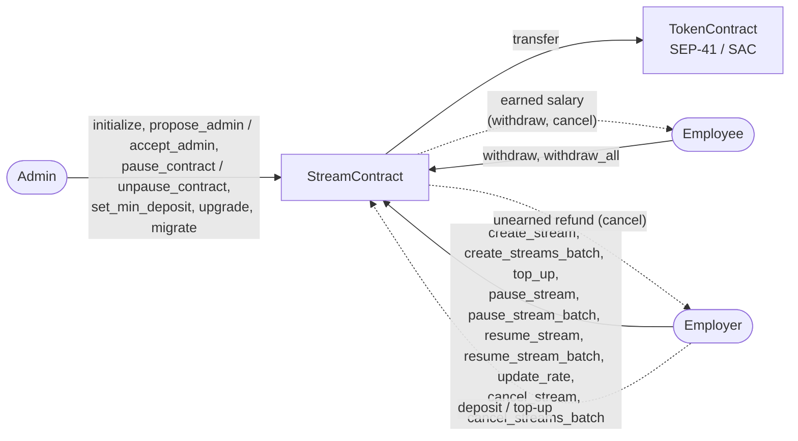
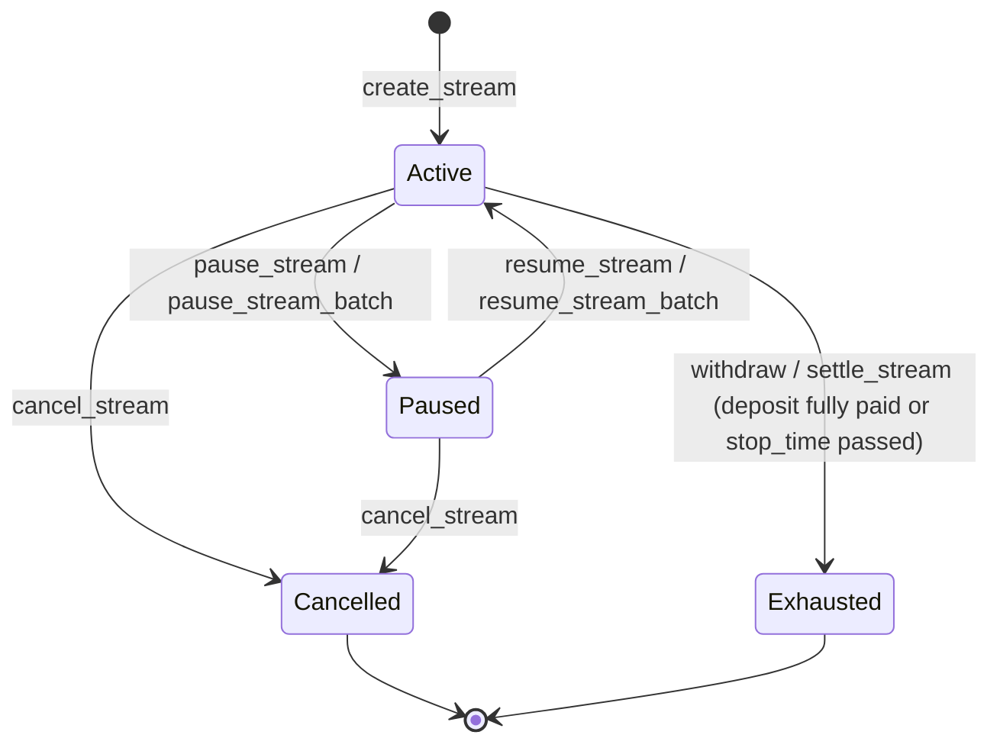

# PayStream Contracts

[](https://github.com/veracindarella/paystream-contracts/actions/workflows/ci.yml)
[](https://codecov.io/gh/veracindarella/paystream-contracts/branch/main)
[](https://github.com/veracindarella/paystream-contracts/actions/workflows/deny.yml)
[](Cargo.toml)
[](LICENSE)

Soroban smart contracts for **PayStream** — decentralized payroll and salary streaming on the Stellar blockchain.

PayStream lets employers stream salaries to employees in real-time, per-second. Instead of waiting for a monthly paycheck, employees earn and can withdraw their salary continuously as they work — fully on-chain, trustless, and transparent.

> **New here?** Create your first testnet stream in 5 minutes with the **[Quickstart](docs/quickstart.md)**.
>
> **Building an integration?** See the **[Integration Guide](docs/integration-guide.md)** for reading events, calling read queries, and submitting transactions safely.
>
> **Deploying the dashboard?** Follow the **[Dashboard Deployment Guide](docs/dashboard-deployment.md)** for Vercel and self-hosted Node setups.

---

## Why PayStream?

- **Real-time pay** — employees access earned wages any time, not just payday
- **Trustless escrow** — funds locked on-chain; employer cannot claw back earned salary
- **Transparent** — every stream, withdrawal, and cancellation is an immutable on-chain event
- **Stellar-native** — built on Stellar's fast, low-fee infrastructure with Soroban smart contracts
- **Flexible** — pause, resume, top-up, or cancel streams; optional hard stop time
- **Multi-token** — each stream can use any [SEP-41](https://github.com/stellar/stellar-protocol/blob/master/ecosystem/sep-0041.md) compliant token; employer and employee can run concurrent streams in different assets
- **Native XLM** — stream Stellar's native asset via its Stellar Asset Contract (SAC) address; no custom token deployment needed (see [docs/testnet.md](docs/testnet.md#native-xlm-streams-sac))
- **Multi-network** — the same indexer and dashboard stack runs against testnet or mainnet; the network is selected by environment, with per-network passphrase, RPC URL, and contract IDs validated at startup

---

## Networks

The indexer and API are not testnet-only. The active network is chosen by environment, and each network supplies its own passphrase, RPC endpoint, and contract IDs. Both the indexer and the API refuse to start if the configured passphrase does not match the network, and contract IDs are validated against the selected network before any work begins — so switching between testnet and mainnet requires no code changes.

See the [operations runbook](docs/operations.md) for the full list of network environment variables and step-by-step instructions for switching networks.

## Indexer Backfill & Catch-Up

The indexer supports two historical modes alongside live streaming:

- **Backfill** — replays contract events from a configurable start ledger (including genesis) to build state on a fresh deployment.
- **Catch-up** — resumes from the persisted high-water mark after downtime, so no events are missed.

Progress is observable and resumable: the high-water mark is persisted, so an interrupted backfill or catch-up continues where it left off. Backfill/catch-up and live modes never overlap, and events are not duplicated. See the [operations runbook](docs/operations.md) and the [dashboard README](dashboard/README.md) for configuration and monitoring details.

---
=======

## Architecture

Solid arrows are contract calls made by each actor; dashed arrows are token transfers.



Anyone can call the read-only functions (`get_stream`, `claimable`, `stream_status`, …) and `settle_stream`.

### Stream Lifecycle



See the [glossary](docs/glossary.md) for terms, the [client guide](docs/client-guide.md) for JavaScript integration examples, and the [integration guide](docs/integration-guide.md) for third-party onboarding (auth, fee estimation, error handling, and the [events schema](docs/events.md)).

---

## Project Structure

```
.
├── contracts
│   ├── stream              # Core salary streaming and escrow contract
│   │   ├── src
│   │   │   ├── lib.rs      # Stream entrypoints
│   │   │   ├── storage.rs  # Persistence and claimable calculation
│   │   │   ├── events.rs   # On-chain event publishing
│   │   │   ├── types.rs    # Domain models and storage keys
│   │   │   └── test.rs     # Contract tests
│   │   └── Cargo.toml
│   └── token               # Fungible payment token contract
│       ├── src
│       │   ├── lib.rs
│       │   ├── storage.rs
│       │   ├── types.rs
│       │   └── test.rs
│       └── Cargo.toml
├── scripts
│   ├── build.sh
│   ├── deploy-local.sh
│   ├── deploy-testnet.sh
│   ├── export-streams.sh     # CSV/JSON export of an employer's streams
│   ├── init-testnet.sh
│   └── sync-labels.sh        # Apply .github/labels.yml to the repository
├── Cargo.toml
├── Makefile
├── CONTRIBUTING.md
├── SECURITY.md
└── README.md
```

---

## Quick Start

### Prerequisites

- [Rust](https://rustup.rs/) (latest stable)
- [Stellar CLI](https://developers.stellar.org/docs/tools/developer-tools/cli/stellar-cli)

```bash
git clone https://github.com/veracindarella/paystream-contracts.git
cd paystream-contracts
rustup target add wasm32-unknown-unknown
```

### Build

```bash
make build
# or: stellar contract build
```

### Test

```bash
make test
# or: cargo test
```

Project coverage is tracked by [Codecov](https://codecov.io/gh/veracindarella/paystream-contracts) and enforced via a required status check: the `codecov/project` check fails CI when total coverage drops below the floor configured in [`codecov.yml`](codecov.yml). Per-target coverage is reported for the `stream` and `token` contracts where useful.

### Format & Lint

```bash
make fmt-check
make lint
```

---

### Docker (no local Rust/Stellar CLI required)

Build and test entirely inside Docker — no local Rust or Stellar CLI installation needed.

**Run tests:**
```bash
docker compose run --rm test
```

**Build contracts only:**
```bash
docker compose run --rm build stellar contract build
```

The `cargo-cache` volume persists the Cargo registry between runs so subsequent builds are fast.

---

## Stream Contract Reference

> Full parameter, return value, error, and example documentation: **[docs/api-reference.md](docs/api-reference.md)**

### Functions

| Function | Caller | Description |
|---|---|---|
| `initialize(admin)` | Admin | Set contract admin |
| `create_stream(employer, employee, token, deposit, rate_per_second, stop_time, low_balance_threshold)` | Employer | Create stream, lock deposit; optional `low_bal` event threshold |
| `create_streams_batch(employer, params)` | Employer | Create multiple streams atomically; all succeed or all revert |
| `withdraw(employee, stream_id)` | Employee | Withdraw all claimable earnings |
| `withdraw_all(employee)` | Employee | Withdraw from all streams in one transaction |
| `top_up(employer, stream_id, amount, low_balance_threshold)` | Employer | Add more funds to active stream; optionally update `low_bal` threshold |
| `set_low_balance_threshold(employer, stream_id, threshold)` | Employer | Adjust or disable (`0`) alert threshold without topping up |
| `pause_stream(employer, stream_id)` | Employer | Pause accrual |
| `pause_stream_batch(employer, stream_ids)` | Employer | Pause multiple streams atomically; all succeed or all revert (max 50) |
| `resume_stream(employer, stream_id)` | Employer | Resume accrual |
| `resume_stream_batch(employer, stream_ids)` | Employer | Resume multiple paused streams atomically; all succeed or all revert (max 50) |
| `cancel_stream(employer, stream_id)` | Employer | Pay employee earned share, refund remainder |
| `cancel_streams_batch(employer, stream_ids)` | Employer | Cancel multiple streams atomically; all succeed or all revert |
| `get_stream(stream_id)` | Anyone | Read stream state |
| `get_streams_batch(stream_ids)` | Anyone | Read up to 50 streams in one call, in input order |
| `get_auto_topup_config(stream_id)` | Anyone | Query recurring auto top-up config for a stream |
| `stream_status(stream_id)` | Anyone | Query stream status only (lightweight) |
| `claimable(stream_id)` | Anyone | Query withdrawable amount right now |
| `stream_count()` | Anyone | Total streams created |
| `stream_count_by_employer(employer)` | Anyone | Number of streams owned by an employer |
| `stream_count_by_employee(employee)` | Anyone | Number of streams paying an employee |

### Batch vs Individual Stream Creation — Fee Comparison

| Approach | Transactions | Approx. fee |
|---|---|---|
| N individual `create_stream` calls | N | N × base fee |
| One `create_streams_batch` call | 1 | 1 × base fee + per-stream resource overhead |

`create_streams_batch` is

---

## Security

To report a vulnerability, please **do not** open a public issue. Instead, email the security team at **security@paystream.dev**. Include a description of the issue, reproduction steps, and any relevant logs. We aim to acknowledge reports within 48 hours.

For encrypted reporting, use our PGP key (fingerprint published in [SECURITY.md](SECURITY.md)) or contact us via Signal at the number listed there.

See [SECURITY.md](SECURITY.md) for the full disclosure policy and supported versions.

## Handsoff notes

<!-- handsoff-issue-428 -->
- #428: SC-60: Add top_up_batch entrypoint
