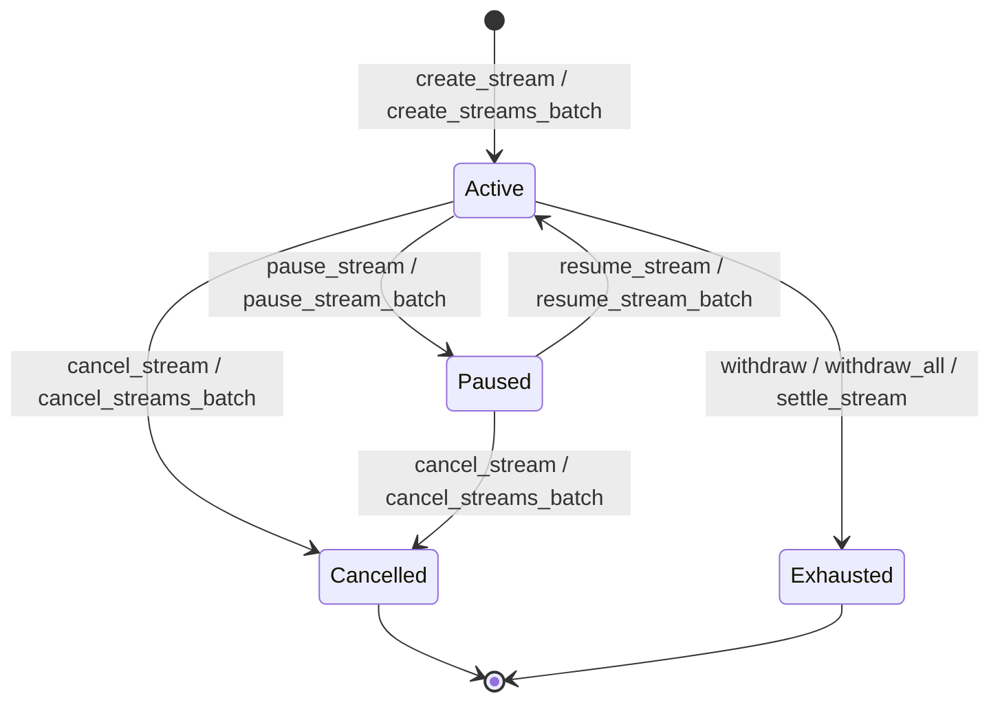

# API Reference

Full documentation for every PayStream contract function: parameters, return values, errors, and CLI examples.

See also: [Error Codes](#error-codes) · [Stream Status Lifecycle](#stream-status-lifecycle) · [Storage Layout](storage-layout.md) (for off-chain indexers)

---

## Stellar Explorer (Stellar Expert) links

Deep links to [Stellar Expert](https://stellar.expert) for the deployed testnet
contracts. Use these to verify transactions and inspect on-chain state without
building custom tooling.

| Contract | Testnet address | Stellar Expert link |
|---|---|---|
| PayStream Token | `CDZQHVQHQMHIGJGSQIJVXGPGNZJQDQV4BBKMG7MSIDTJTTBBQYAEUPB` | <https://stellar.expert/explore/testnet/contract/CDZQHVQHQMHIGJGSQIJVXGPGNZJQDQV4BBKMG7MSIDTJTTBBQYAEUPB> |
| PayStream Stream | `CBXKDJUQYQDQKSQT6AKZRQWXDXTQHVXHBQQJQ3WKDXJHPNMRGYAQMRS` | <https://stellar.expert/explore/testnet/contract/CBXKDJUQYQDQKSQT6AKZRQWXDXTQHVXHBQQJQ3WKDXJHPNMRGYAQMRS> |

> The contract addresses above mirror [docs/testnet.md](testnet.md#current-contract-ids).
> When `testnet.md` is updated as part of a release, update this table to match so
> the explorer links stay current. A future improvement is to template these URLs
> from `testnet.md` so they auto-update on every release.

> **Mainnet:** Placeholder section added until mainnet launch. Mainnet contract IDs
> and Stellar Explorer links (mainnet network) will be published here after the
> mainnet prototype (PROD-34 / issue #323) is deployed. See [docs/mainnet.md](mainnet.md).

---

## REST API (v1)

The backend exposes the indexed stream data over a versioned REST API so
dashboards and integrators do not need to query the chain directly. All
endpoints are prefixed with `/v1`; breaking changes ship under a new version
prefix.

The machine-readable contract is committed as
[`docs/openapi.yaml`](openapi.yaml) and is rendered by the docs site. The
sections below summarise the endpoints; the OpenAPI document is the source of
truth for schemas, status codes and examples.

**Base URL:** `https://api.paystream.example/v1` (testnet deployments may use a
different host — see [testnet.md](testnet.md)).

### Conventions

- **Content type:** requests and responses are `application/json`.
- **Addresses:** Stellar addresses (`G...` account or `C...` contract) are
  passed as path parameters and validated before any lookup.
- **Pagination:** list endpoints accept `limit` and `offset` query parameters.
  - `limit` — page size, integer `1`–`100`, default `20`.
  - `offset` — number of records to skip, integer `≥ 0`, default `0`.
  - Responses include a `pagination` object: `{ "limit", "offset", "total" }`,
    where `total` is the number of matching records across all pages.
- **Timestamps:** Unix seconds, encoded as JSON numbers.
- **Amounts:** `i128` token amounts are encoded as JSON strings to avoid
  precision loss in JavaScript clients.

### Request validation

Every request is validated before it reaches the indexer. Invalid input returns
`400 Bad Request` with an error body:

```json
{ "error": "validation_error", "message": "limit must be between 1 and 100" }
```

Validation rules:

| Input | Rule | Failure |
|---|---|---|
| `{id}` (stream ID) | Must be an unsigned 64-bit integer | `400` |
| `{addr}` (employer/employee/admin) | Must be a valid Stellar address (strkey) | `400` |
| `limit` | Integer `1`–`100` | `400` |
| `offset` | Integer `≥ 0` | `400` |
| Unknown query parameters | Rejected | `400` |

### 404 handling

When a path parameter is valid but no matching record exists, the API returns
`404 Not Found`:

```json
{ "error": "not_found", "message": "stream 42 not found" }
```

List endpoints for an address with no streams return `200 OK` with an empty
`data` array and `total: 0` — they do **not** return `404`.

---

### `GET /v1/streams/{id}`

Return the indexed state of a single stream.

**Path parameters:**

| Name | Type | Description |
|---|---|---|
| `id` | `u64` | Stream ID |

**Response `200 OK`:**

```json
{
  "id": 42,
  "employer": "G...",
  "employee": "G...",
  "token": "C...",
  "deposit": "1000000",
  "withdrawn": "250000",
  "rate_per_second": "100",
  "start_time": 1714569600,
  "stop_time": 0,
  "last_withdraw_time": 1714656000,
  "status": "Active",
  "stream_type": "Payroll",
  "claimable": "50000",
  "claimable_at": 1714742400
}
```

**Claimable snapshot:** `claimable` is **not** read from the index. It is
computed from the on-chain `claimable(stream_id)` view at request time, so the
value always reflects the current ledger. `claimable_at` records the ledger
timestamp at which the snapshot was taken. If the chain is unreachable the
endpoint returns `503 Service Unavailable` rather than a stale value.

**Errors:** `400` invalid ID · `404` stream not found · `503` chain unavailable.

---

### `GET /v1/employers/{addr}/streams`

List streams funded by an employer, in creation order.

**Path parameters:**

| Name | Type | Description |
|---|---|---|
| `addr` | `Address` | Employer address |

**Query parameters:** `limit`, `offset` (see [Pagination](#conventions)).

**Response `200 OK`:**

```json
{
  "data": [ { "id": 42, "...": "..." } ],
  "pagination": { "limit": 20, "offset": 0, "total": 3 }
}
```

Each item uses the same shape as `GET /v1/streams/{id}`, including the
request-time `claimable` snapshot.

**Errors:** `400` invalid address or pagination · `503` chain unavailable.

---

### `GET /v1/employees/{addr}/streams`

List streams paying an employee, in creation order.

**Path parameters:**

| Name | Type | Description |
|---|---|---|
| `addr` | `Address` | Employee address |

**Query parameters:** `limit`, `offset` (see [Pagination](#conventions)).

**Response `200 OK`:** same envelope as the employer list, with each item
carrying a request-time `claimable` snapshot.

**Errors:** `400` invalid address or pagination · `503` chain unavailable.

---

### `GET /v1/admins/{addr}/audit`

Return the governance audit trail for an admin address, newest first. Covers
admin nonce changes, `propose_admin` / `accept_admin`, `pause_contract` /
`unpause_contract`, `set_min_deposit`, `set_protocol_fee`, and the upgrade
lifecycle (`propose_upgrade`, `execute_upgrade`, `cancel_upgrade`).

**Path parameters:**

| Name | Type | Description |
|---|---|---|
| `addr` | `Address` | Admin address |

**Query parameters:**

| Name | Type | Description |
|---|---|---|
| `limit` | `u32` | Page size, `1`–`100`, default `20` |
| `offset` | `u32` | Records to skip, default `0` |
| `action` | `string` | Optional filter, e.g. `pause_contract`, `set_protocol_fee` |
| `from` | `u64` | Optional inclusive lower bound on ledger timestamp |
| `to` | `u64` | Optional exclusive upper bound on ledger timestamp |

**Response `200 OK`:**

```json
{
  "data": [
    {
      "action": "set_protocol_fee",
      "admin": "G...",
      "nonce": 7,
      "ledger": 1234567,
      "timestamp": 1714742400,
      "tx_hash": "...",
      "details": { "fee_bps": 10, "treasury": "G..." }
    }
  ],
  "pagination": { "limit": 20, "offset": 0, "total": 1 }
}
```

The `nonce` field is reconstructed from the indexed events, so the sequence of
admin actions can be audited without replaying the ledger. Unexpected admin
actions (e.g. a pause or upgrade not announced out-of-band) raise an alert in
the indexer's monitoring; see [events-schema.md](events-schema.md) for the
underlying events.

**Errors:** `400` invalid address, pagination or filter · `503` chain unavailable.

---

## Stream Contract

### `initialize`

Set the contract admin. Must be called once after deployment before any other function.

Emits a `contract_initialized` event on success so off-chain indexers can determine when and by whom the contract was initialised.

**Caller:** Admin

| Parameter | Type | Description |
|---|---|---|
| `admin` | `Address` | Address that will become the contract admin |

**Returns:** nothing

**Errors:**
- Panics if `admin` auth fails
- Panics with "already initialized" if called more than once (SC-01 / LOW-02)

**Example:**
```bash
stellar contract invoke --id <STREAM_ID> --source <ADMIN_KEY> --network testnet \
  -- initialize --admin <ADMIN_ADDRESS>
```

---

### `propose_admin`

Step 1 of a two-step admin transfer. Current admin nominates a new admin.

**Caller:** Current admin

| Parameter | Type | Description |
|---|---|---|
| `new_admin` | `Address` | Address being nominated as the next admin |

**Returns:** nothing

**Errors:**
- Panics if caller is not the current admin

**Example:**
```bash
stellar contract invoke --id <STREAM_ID> --source <ADMIN_KEY> --network testnet \
  -- propose_admin --new_admin <NEW_ADMIN_ADDRESS>
```

---

### `accept_admin`

Step 2 of a two-step admin transfer. Nominated admin accepts and becomes the new admin.

**Caller:** Nominated (pending) admin

| Parameter | Type | Description |
|---|---|---|
| `new_admin` | `Address` | Must match the address set by `propose_admin` |

**Returns:** nothing

**Errors:**
- Panics if there is no pending admin
- Panics if `new_admin` does not match the pending admin

**Example:**
```bash
stellar contract invoke --id <STREAM_ID> --source <NEW_ADMIN_KEY> --network testnet \
  -- accept_admin --new_admin <NEW_ADMIN_ADDRESS>
```

---

### `pause_contract`

Admin pauses the entire contract. Blocks `create_stream`, `create_streams_batch`, and `withdraw`.

**Caller:** Admin

| Parameter | Type | Description |
|---|---|---|
| `nonce` | `u64` | Current admin nonce (replay protection) |

**Returns:** nothing

**Errors:**
- Panics if caller is not the admin
- Panics if `nonce` does not match the stored nonce (E009)

**Example:**
```bash
stellar contract invoke --id <STREAM_ID> --source <ADMIN_KEY> --network testnet \
  -- pause_contract --nonce 0
```

---

### `unpause_contract`

Admin unpauses the contract, restoring normal operation.

**Caller:** Admin

| Parameter | Type | Description |
|---|---|---|
| `nonce` | `u64` | Current admin nonce (replay protection) |

**Returns:** nothing

**Errors:**
- Panics if caller is not the admin
- Panics if `nonce` does not match the stored nonce (E009)

**Example:**
```bash
stellar contract invoke --id <STREAM_ID> --source <ADMIN_KEY> --network testnet \
  -- unpause_contract --nonce 1
```

---

### `set_min_deposit`

Admin sets the minimum deposit enforced on `create_stream`.

**Caller:** Admin

| Parameter | Type | Description |
|---|---|---|
| `admin` | `Address` | Must equal the stored admin |
| `nonce` | `u64` | Current admin nonce (replay protection) |
| `amount` | `i128` | New minimum deposit (must be > 0) |

**Returns:** nothing

**Errors:**
- Panics if `admin` auth fails or does not match stored admin
- Panics if `nonce` is wrong (E009)
- Panics if `amount` ≤ 0 (E002)

**Example:**
```bash
stellar contract invoke --id <STREAM_ID> --source <ADMIN_KEY> --network testnet \
  -- set_min_deposit --admin <ADMIN_ADDRESS> --nonce 2 --amount 100000
```

---

### `expire_streams`

Admin batch-expires streams that crossed `stop_time + GRACE_PERIOD` and have no remaining claimable tokens. Ineligible entries are skipped without reverting. The admin nonce is consumed even when every stream is skipped.
### `set_protocol_fee`

Admin configures the fee charged on stream creation. The fee is deducted from the gross deposit before the net amount is locked in escrow. `fee_bps` is capped at 100 (1%); setting it to 0 disables fees.

**Caller:** Admin

| Parameter | Type | Description |
|---|---|---|
| `admin` | `Address` | Must equal the stored admin |
| `nonce` | `u64` | Current admin nonce (replay protection) |
| `stream_ids` | `Vec<u64>` | Streams to evaluate; each must be `Active`, have `stop_time > 0`, `now > stop_time + GRACE_PERIOD`, and `claimable == 0` to expire |

**Returns:** nothing

**Errors:**
- Panics if `admin` auth fails or does not match the stored admin
- Panics if `nonce` does not match the stored admin nonce (E009)
| `fee_bps` | `u16` | Fee in basis points, from 0 to 100 |
| `treasury` | `Address` | Address receiving collected fees |

**Errors:** Panics if the caller is not the admin, the nonce is wrong, or `fee_bps` exceeds 100.

**Example:**
```bash
stellar contract invoke --id <STREAM_ID> --source <ADMIN_KEY> --network testnet \
  -- expire_streams --admin <ADMIN_ADDRESS> --nonce 3 --stream_ids '[1,2,3]'
  -- set_protocol_fee --admin <ADMIN_ADDRESS> --nonce 2 --fee_bps 10 --treasury <TREASURY_ADDRESS>
```

---

### `get_protocol_fee`

Return the configured protocol fee and treasury. Before configuration, returns `(0, None)`.

**Caller:** Anyone

**Returns:** `(u16, Option<Address>)` — fee in basis points and optional treasury address

**Example:**
```bash
stellar contract invoke --id <STREAM_ID> --source <ANY_KEY> --network testnet \
  -- get_protocol_fee
```

---

### `get_protocol_fee_config`

Return the current protocol fee configuration in a single read-only call, for
dashboards and integrators that need to display the fee. Returns `None` when
fees are disabled (`fee_bps == 0`), otherwise the fee in basis points and the
treasury address that receives collected fees.

**Caller:** Anyone (no auth required)

**Parameters:** none

**Returns:** `Option<(u32, Address)>` — `None` when fees are disabled, otherwise
`Some((fee_bps, treasury))`

**Example:**
```bash
stellar contract invoke --id <STREAM_ID> --source <ANY_KEY> --network testnet \
  -- get_protocol_fee_config
```

---

### `archive_stream_indexes`

Admin entry point (SC-93) that moves the `EmployerStreams`, `EmployeeStreams`
and `TokenStreams` secondary indexes for the supplied streams out of persistent
storage into temporary storage with a TTL, cutting rent for older/completed
streams. The stream records themselves are untouched.

**Caller:** Admin

| Parameter | Type | Description |
|---|---|---|
| `admin` | `Address` | Must equal the stored admin |
| `nonce` | `u64` | Current admin nonce (replay protection) |
| `stream_ids` | `Vec<u64>` | Streams whose index entries should be archived (max 50) |

**Returns:** nothing

**Errors:**
- Panics if `admin` auth fails or does not match the stored admin
- Panics if `nonce` does not match the stored admin nonce (E009)
- E029 if `stream_ids` contains more than 50 entries

**Note:** Index queries (`stream_ids_by_employer`, `stream_ids_by_employee`,
`stream_ids_by_token`, and their paginated/count variants) transparently
include archived entries, so archival causes no query regressions.

**Example:**
```bash
stellar contract invoke --id <STREAM_ID> --source <ADMIN_KEY> --network testnet \
  -- archive_stream_indexes --admin <ADMIN_ADDRESS> --nonce 4 --stream_ids '[1,2,3]'
```

---

### `create_stream`

Employer creates a salary stream and deposits funds into the contract escrow.

**Caller:** Employer

| Parameter | Type | Description |
|---|---|---|
| `employer` | `Address` | Employer address; funds are pulled from here |
| `employee` | `Address` | Employee address; receives streamed tokens |
| `token_address` | `Address` | SEP-41 token contract address |
| `deposit` | `i128` | Gross amount; configured fee is deducted before the net amount is locked in escrow |
| `rate_per_second` | `i128` | Tokens streamed per second |
| `stop_time` | `u64` | Hard stop timestamp (0 = indefinite). Must not exceed `now + MAX_STOP_TIME_OFFSET` (10 years) |
| `low_balance_threshold` | `Option<i128>` | Emit a `low_bal` event after any withdraw that leaves less than this remaining (`None`/0 = disabled) |
| `cliff_time` | `Option<u64>` | Cliff timestamp (PROD-17). Nothing accrues before it; once passed, accrual runs from `cliff_time` (not from the start). `None`, or a cliff at/before now, means no cliff |
| `immutable` | `bool` | SC-77. When `true`, the stream is non-cancellable and non-pausable by the employer (e.g. guaranteed salary). Funds remain withdrawable by the employee and top-ups are still allowed |
| `rate_schedule` | `Option<Vec<(u64, i128)>>` | SC-79. Optional forward schedule of `(timestamp, rate)` pairs, sorted ascending by timestamp. The active rate advances automatically at each timestamp; see `set_rate_schedule` for validation rules |

**Returns:** `u64` — the new stream ID

**Immutable streams (SC-77):** when `immutable` is `true`, `cancel_stream`,
`cancel_streams_batch`, `pause_stream` and `pause_stream_batch` reject the stream
with `E036`. `top_up`, `withdraw`, `withdraw_all`, `withdraw_to` and
`update_rate` continue to work. Read the flag with `is_immutable(stream_id) -> bool`.

**Cliff behaviour:** `claimable` is 0 while `now < cliff_time`. Withdrawing,
pausing/resuming or changing the rate before the cliff never moves accrual
earlier than the cliff. Cancelling before the cliff refunds the full deposit to
the employer. The first `withdraw` / `withdraw_all` / `cancel_stream` /
`settle_stream` call at or after the cliff emits `cliff_reached` once. Read the
cliff with `get_cliff_time(stream_id) -> Option<u64>`.

**Errors:**
- Panics if contract is paused
- E035 if `cliff_time` > `stop_time` (when `stop_time` is non-zero)
- E037 if `rate_schedule` is not strictly ascending by timestamp, contains a timestamp in the past, or contains a rate outside `1..=1,000,000,000`
- E002 if `deposit` ≤ 0
- E007 if `deposit` < minimum deposit
- E001 if `rate_per_second` ≤ 0
- E008 if `rate_per_second` > 1,000,000,000
- Panics if `stop_time` is in the past (when non-zero)
- E036 (`ERR_STOP_TIME_TOO_FAR`) if `stop_time` > `now + MAX_STOP_TIME_OFFSET` (10 years, i.e. `now + 315_360_000` seconds)
- Panics if `employer` == `employee`
- Panics if token transfer fails (insufficient balance or allowance)

**Example:**
```bash
stellar contract invoke --id <STREAM_ID> --source <EMPLOYER_KEY> --network testnet \
  -- create_stream \
    --employer <EMPLOYER_ADDRESS> \
    --employee <EMPLOYEE_ADDRESS> \
    --token_address <TOKEN_ID> \
    --deposit 1000000 \
    --rate_per_second 100 \
    --stop_time 0 \
    --low_balance_threshold 100000 \
    --immutable false \
    --rate_schedule 'null'
```

**Example (immutable stream with a rate schedule):**
```bash
stellar contract invoke --id <STREAM_ID> --source <EMPLOYER_KEY> --network testnet \
  -- create_stream \
    --employer <EMPLOYER_ADDRESS> \
    --employee <EMPLOYEE_ADDRESS> \
    --token_address <TOKEN_ID> \
    --deposit 1000000 \
    --rate_per_second 100 \
    --stop_time 0 \
    --low_balance_threshold 100000 \
    --immutable true \
    --rate_schedule '[[1735689600,100],[1738368000,150],[1740787200,200]]'
```

---

### `create_linear_vest`

Employer creates a fixed grant that vests linearly over `vest_period`. The grant is the gross deposit; any configured protocol fee is deducted before the net grant is escrowed. An optional cliff delays all claimability until the cliff duration has elapsed, while vesting accrues from the start time. Paused time is excluded from the vesting period.

**Caller:** Employer

| Parameter | Type | Description |
|---|---|---|
| `employer` | `Address` | Employer funding the grant |
| `employee` | `Address` | Grant recipient |
| `token_address` | `Address` | SEP-41 token contract address |
| `total_grant` | `i128` | Gross grant amount (must meet minimum deposit) |
| `vest_period` | `u64` | Vesting duration in seconds; must be greater than zero |
| `cliff` | `Option<u64>` | Optional cliff duration in seconds; must not exceed `vest_period` |

**Returns:** `u64` — the new stream ID

**Example:**
```bash
stellar contract invoke --id <STREAM_ID> --source <EMPLOYER_KEY> --network testnet \
  -- create_linear_vest --employer <EMPLOYER_ADDRESS> \
  --employee <EMPLOYEE_ADDRESS> --token_address <TOKEN_ID> \
  --total_grant 1000000 --vest_period 31536000 --cliff 7776000
```

---

### `create_milestone_vest`

Employer creates a grant that vests in discrete milestones instead of linearly
(SC-78). Each milestone is a `(timestamp, fraction_bps)` pair: when the ledger
timestamp reaches `timestamp`, `fraction_bps` basis points of the total grant
become claimable. Fractions are cumulative — each entry states the total vested
fraction at that timestamp, not an increment — and must be non-decreasing, end
at or below 10,000, and be sorted ascending by timestamp. An optional cliff
delays all claimability until the cliff timestamp.

**Caller:** Employer

| Parameter | Type | Description |
|---|---|---|
| `employer` | `Address` | Employer funding the grant |
| `employee` | `Address` | Grant recipient |
| `token_address` | `Address` | SEP-41 token contract address |
| `total_grant` | `i128` | Gross grant amount (must meet minimum deposit) |
| `milestones` | `Vec<(u64, u32)>` | Sorted `(timestamp, cumulative fraction in bps)` pairs |
| `cliff_time` | `Option<u64>` | Optional cliff timestamp; nothing is claimable before it |

**Returns:** `u64` — the new stream ID

**Claimable:** `claimable` sums the vested milestones up to `now`:
`total_grant * vested_bps / 10_000 - withdrawn`, capped at the remaining
deposit. Before the cliff, claimable is 0. At exactly a milestone timestamp the
milestone counts as vested.

**Errors:**
- E002 if `total_grant` ≤ 0
- E007 if `total_grant` < minimum deposit
- E038 if `milestones` is empty, not sorted ascending, contains a fraction above 10,000, or contains a decreasing fraction
- E035 if `cliff_time` is after the last milestone timestamp

**Example:**
```bash
stellar contract invoke --id <STREAM_ID> --source <EMPLOYER_KEY> --network testnet \
  -- create_milestone_vest --employer <EMPLOYER_ADDRESS> \
  --employee <EMPLOYEE_ADDRESS> --token_address <TOKEN_ID> \
  --total_grant 1000000 \
  --milestones '[[1735689600,2500],[1751328000,5000],[1767225600,10000]]' \
  --cliff_time 1735689600
```

---

### `get_milestone_schedule`

Return the milestone schedule and cliff for a milestone vest. Returns `None`
for streams of any other type.

**Caller:** Anyone

| Parameter | Type | Description |
|---|---|---|
| `stream_id` | `u64` | Stream to query |

**Returns:** `Option<MilestoneSchedule>` — schedule containing `milestones: Vec<(u64, u32)>` and `cliff_time: Option<u64>`

---

### `get_stream_type`

Return whether a stream is `Payroll`, `LinearVest`, or `Milestone`. Existing streams without type metadata are treated as `Payroll`.

**Caller:** Anyone

| Parameter | Type | Description |
|---|---|---|
| `stream_id` | `u64` | Stream to query |

**Returns:** `StreamType` — `Payroll`, `LinearVest`, or `Milestone`

---

### `get_linear_vest_schedule`

Return the grant amount, vest duration, and optional cliff for a linear vest. Returns `None` for payroll streams.

**Caller:** Anyone

| Parameter | Type | Description |
|---|---|---|
| `stream_id` | `u64` | Stream to query |

**Returns:** `Option<LinearVestSchedule>` — schedule containing `total_grant`, `vest_period`, and `cliff`

---

### `create_split_vest`

Employer creates a linear vest grant whose claimable tokens are split between a
primary beneficiary and one or more additional beneficiaries. Vesting follows the
same rules as `create_linear_vest` (optional cliff, paused time excluded), but each
`withdraw` pays out the caller's share of the claimable amount according to the
configured split. Split rules match `create_split_stream`: shares are expressed in
basis points and must sum to exactly 10,000 (100%).

**Caller:** Employer

| Parameter | Type | Description |
|---|---|---|
| `employer` | `Address` | Employer funding the grant |
| `employee` | `Address` | Primary grant recipient |
| `token_address` | `Address` | SEP-41 token contract address |
| `total_grant` | `i128` | Gross grant amount (must meet minimum deposit) |
| `vest_period` | `u64` | Vesting duration in seconds; must be greater than zero |
| `cliff` | `Option<u64>` | Optional cliff duration in seconds; must not exceed `vest_period` |
| `splits` | `Vec<(Address, u32)>` | Beneficiary / share pairs in basis points; shares must sum to 10,000 |

**Returns:** `u64` — the new stream ID

**Errors:**
- Same validations as `create_linear_vest` (E002, E007, E035, paused contract)
- Panics if `splits` is empty, contains duplicate beneficiaries, or shares do not sum to 10,000
- Panics if any share is 0

**Example:**
```bash
stellar contract invoke --id <STREAM_ID> --source <EMPLOYER_KEY> --network testnet \
  -- create_split_vest --employer <EMPLOYER_ADDRESS> \
  --employee <EMPLOYEE_ADDRESS> --token_address <TOKEN_ID> \
  --total_grant 1000000 --vest_period 31536000 --cliff 7776000 \
  --splits '[["<BENEFICIARY_1>",6000],["<BENEFICIARY_2>",4000]]'
```

---

### `update_stream_metadata`

Employer sets or replaces the bounded metadata map attached to a stream (SC-99).
Metadata is intended for payroll categorization (for example `department` or
`cost center`) and is stored in persistent storage keyed by stream ID.

**Caller:** Employer

| Parameter | Type | Description |
|---|---|---|
| `employer` | `Address` | Must match the stream's employer (requires auth) |
| `stream_id` | `u64` | ID of the stream to update |
| `metadata` | `Map<Symbol, String>` | Metadata entries; at most `MAX_METADATA_ENTRIES` (8) entries, each key ≤ 32 chars and value ≤ 64 chars |

**Returns:** nothing

**Errors:**
- Panics if stream not found (E015)
- Panics if caller is not the stream's employer (E018)
- Panics if `metadata` contains more than 8 entries or any key/value exceeds the length cap

**Example:**
```bash
stellar contract invoke --id <STREAM_ID> --source <EMPLOYER_KEY> --network testnet \
  -- update_stream_metadata --employer <EMPLOYER_ADDRESS> --stream_id 1 \
  --metadata '{"department":"Engineering","cost_center":"CC-42"}'
```

---

### `get_stream_metadata`

Return the metadata map attached to a stream. Returns an empty map when no
metadata has been set, so callers can query unconditionally.

**Caller:** Anyone

| Parameter | Type | Description |
|---|---|---|
| `stream_id` | `u64` | ID of the stream to query |

**Returns:** `Map<Symbol, String>` — metadata entries (empty if unset)

**Errors:**
- Panics if stream not found (E015)

**Example:**
```bash
stellar contract invoke --id <STREAM_ID> --source <ANY_KEY> --network testnet \
  -- get_stream_metadata --stream_id 1
```

---

### `set_max_batch_size`

Admin sets the maximum number of entries accepted by batch entrypoints
(`create_streams_batch`, `cancel_streams_batch`, `pause_stream_batch`,
`resume_stream_batch`, `get_streams_batch`, `claimable_batch`). The value is
bounded to `1..=200` and defaults to 50 when never configured (SC-115).

**Caller:** Admin

| Parameter | Type | Description |
|---|---|---|
| `admin` | `Address` | Must equal the stored admin |
| `nonce` | `u64` | Current admin nonce (replay protection) |
| `max` | `u32` | New maximum batch size, from 1 to 200 inclusive |

**Returns:** nothing

**Errors:**
- Panics if `admin` auth fails or does not match stored admin
- Panics if `nonce` is wrong (E009)
- Panics if `max` is 0 or greater than 200

**Example:**
```bash
stellar contract invoke --id <STREAM_ID> --source <ADMIN_KEY> --network testnet \
  -- set_max_batch_size --admin <ADMIN_ADDRESS> --nonce 4 --max 100
```

---

### `create_streams_batch`

Employer creates multiple salary streams atomically. All streams succeed or all revert.
=======

**Caller:** Employer

| Parameter | Type | Description |
|---|---|---|
| `employer` | `Address` | Employer address |
| `params` | `Vec<StreamParams>` | List of stream parameters (see below) |

**`StreamParams` fields:**

| Field | Type | Description |
|---|---|---|
| `employee` | `Address` | Employee address |
| `token` | `Address` | SEP-41 token contract address |
| `deposit` | `i128` | Gross deposit; any configured protocol fee is deducted before escrow |
| `rate_per_second` | `i128` | Tokens per second for this stream |
| `stop_time` | `u64` | Hard stop timestamp (0 = indefinite). Must not exceed `now + MAX_STOP_TIME_OFFSET` (10 years) |
| `cliff_time` | `Option<u64>` | Optional cliff (PROD-17); same rules as `create_stream`. Also stored in templates |
| `low_balance_threshold` | `Option<i128>` | Optional low-balance alert threshold for this stream; same rules as `create_stream`. When omitted (`None`), the threshold defaults to `0` (alert disabled). Also stored in templates |

**Returns:** `Vec<u64>` — list of new stream IDs in the same order as `params`

**Limit:** Up to the configured maximum batch size per call (default 50, tunable via `set_max_batch_size` in the range 1–200)

**Errors:** Same per-stream validations as `create_stream`, including protocol fee deduction and the 10-year `stop_time` cap (E036 `ERR_STOP_TIME_TOO_FAR`); panics if `params` is empty or contains more entries than the configured maximum batch size (E029). Any single invalid entry reverts the whole batch.

**Example:**
```bash
stellar contract invoke --id <STREAM_ID> --source <EMPLOYER_KEY> --network testnet \
  -- create_streams_batch \
    --employer <EMPLOYER_ADDRESS> \
    --params '[{"employee":"<ADDR1>","token":"<TOKEN_ID>","deposit":500000,"rate_per_second":50,"stop_time":0},{"employee":"<ADDR2>","token":"<TOKEN_ID>","deposit":500000,"rate_per_second":50,"stop_time":0}]'
```

---

### `withdraw`

Employee withdraws all claimable tokens earned so far.

**Caller:** Employee

| Parameter | Type | Description |
|---|---|---|
| `employee` | `Address` | Must match the stream's employee |
| `stream_id` | `u64` | ID of the stream to withdraw from |

**Returns:** `i128` — amount transferred (0 if nothing claimable)

**Errors:**
- Panics if contract is paused
- Panics if stream not found
- Panics if caller is not the stream's employee
- Panics if stream is not Active or Exhausted
- E003 if a reentrant withdraw is detected

**Example:**
```bash
stellar contract invoke --id <STREAM_ID> --source <EMPLOYEE_KEY> --network testnet \
  -- withdraw --employee <EMPLOYEE_ADDRESS> --stream_id 1
```

---

### `settle_stream`

Anyone may finalize an Active stream after its `stop_time` is reached. Any remaining
claimable tokens are transferred to the current stream receipt holder, then the
stream transitions to `Exhausted` and emits a `status` event. No caller authorization
is required.

| Parameter | Type | Description |
|---|---|---|
| `stream_id` | `u64` | ID of the stream to settle |

**Errors:**
- Panics if the stream is not found
- Panics if the stream is not Active
- Panics if `stop_time` is unset or has not been reached

**Example:**
```bash
stellar contract invoke --id <STREAM_ID> --source <KEEPER_KEY> --network testnet \
  -- settle_stream --stream_id 1
```

---

### `withdraw_to`

Employee withdraws claimable tokens from a stream directly to a different
recipient address (SC-80), for example a savings wallet. The stream receipt
holder authorizes the call; the claimable balance decrements exactly as with
`withdraw`, but the tokens are transferred to `to` instead of the holder.

**Caller:** Employee (stream receipt holder)

| Parameter | Type | Description |
|---|---|---|
| `employee` | `Address` | Must match the stream's employee (requires auth) |
| `stream_id` | `u64` | ID of the stream to withdraw from |
| `to` | `Address` | Recipient of the withdrawn tokens (requires auth) |

**Returns:** `i128` — amount transferred (0 if nothing claimable)

**Errors:**
- Panics if contract is paused
- Panics if stream not found
- Panics if caller is not the stream's employee
- Panics if stream is not Active or Exhausted
- E003 if a reentrant withdraw is detected

**Emitted event:** `withdrew` with the `to` address in the payload (see [events schema](events-schema.md))

**Example:**
```bash
stellar contract invoke --id <STREAM_ID> --source <EMPLOYEE_KEY> --network testnet \
  -- withdraw_to --employee <EMPLOYEE_ADDRESS> --stream_id 1 --to <SAVINGS_ADDRESS>
```

---

### `withdraw_all`

Employee withdraws all claimable tokens from every stream they receive in a single transaction. Auth is checked once. Cancelled and Paused streams are silently skipped; streams with nothing claimable are also skipped.

**Caller:** Employee

| Parameter | Type | Description |
|---|---|---|
| `employee` | `Address` | Employee address (requires auth, checked once) |

**Returns:** `Vec<i128>` — amounts transferred in employee stream-index order, with one entry per stream that paid out; empty if nothing was claimable

**Per-call limit (SC-58):** A single `withdraw_all` call processes at most
`MAX_WITHDRAW_ALL_BATCH` = **50** streams from the employee's index. Employees
with more than 50 streams must call `withdraw_all` repeatedly; each call
advances past the streams it processed, so successive calls drain the remaining
streams. The call is atomic — either every stream in the chunk is paid out and
persisted, or the whole call reverts, so no partial state is ever left behind.

**Signalling remaining streams:** When the employee's index holds more streams
than the cap, the call emits a `withdraw_all_chunked` event carrying the number
of streams processed and the number still remaining (see
[Events](#withdraw_all_chunked)). Clients should keep calling `withdraw_all`
until the event reports `remaining = 0` (or the returned vector is empty).

**Errors:**
- Panics if contract is paused
- E003 if a reentrant withdraw is detected on any stream

**Gas note:** Each stream in the chunk incurs one `token::transfer` cross-contract call. For a 10-stream portfolio this is roughly 10× the cost of a single `withdraw` call; the 50-stream cap keeps a single call within the instruction budget.

**Example:**
```bash
stellar contract invoke --id <STREAM_ID> --source <EMPLOYEE_KEY> --network testnet \
  -- withdraw_all --employee <EMPLOYEE_ADDRESS>
```

---

### `top_up`

Employer adds more funds to an active stream.

**Caller:** Employer

| Parameter | Type | Description |
|---|---|---|
| `employer` | `Address` | Must match the stream's employer |
| `stream_id` | `u64` | ID of the stream to top up |
| `amount` | `i128` | Additional tokens to deposit |

**Returns:** nothing

**Errors:**
- Panics if stream not found
- Panics if caller is not the stream's employer
- E005 if stream is Cancelled
- E006 if stream is Exhausted
- Panics if `amount` ≤ 0
- Panics if token transfer fails

**Example:**
```bash
stellar contract invoke --id <STREAM_ID> --source <EMPLOYER_KEY> --network testnet \
  -- top_up --employer <EMPLOYER_ADDRESS> --stream_id 1 --amount 500000
```

---

### `set_low_balance_threshold`

Employer updates the low-balance alert threshold for a stream at any time without topping up. Setting the threshold to `0` disables the alert.

**Caller:** Employer

| Parameter | Type | Description |
|---|---|---|
| `employer` | `Address` | Must match the stream's employer (requires auth) |
| `stream_id` | `u64` | ID of the stream to update |
| `threshold` | `i128` | New alert threshold in deposit tokens (≥ 0; 0 disables alert) |

**Returns:** nothing

**Errors:**
- Panics if stream not found (E015)
- Panics if caller is not the stream's employer (E018)
- E005 if stream is Cancelled
- E006 if stream is Exhausted
- Panics if `threshold` < 0

**Example:**
```bash
stellar contract invoke --id <STREAM_ID> --source <EMPLOYER_KEY> --network testnet \
  -- set_low_balance_threshold --employer <EMPLOYER_ADDRESS> --stream_id 1 --threshold 500000
```

---

### `set_auto_topup`

Employer pre-authorizes recurring top-ups. After each `withdraw` / `withdraw_all`, if `deposit - withdrawn < trigger_threshold`, the contract pulls `topup_amount` from the employer via `transfer_from` (capped so the cumulative total never exceeds `max_total`). The employer must first `approve` the stream contract as spender for at least `max_total`. If the allowance or balance is insufficient, the top-up is skipped and the withdraw still succeeds. Calling again replaces the config and resets the running total.

**Caller:** Employer

| Parameter | Type | Description |
|---|---|---|
| `employer` | `Address` | Must match the stream's employer |
| `stream_id` | `u64` | ID of the stream |
| `trigger_threshold` | `i128` | Remaining balance below which a top-up fires (> 0) |
| `topup_amount` | `i128` | Amount per top-up (> 0, ≤ `max_total`) |
| `max_total` | `i128` | Cap on cumulative auto top-ups |

**Auth:** `employer.require_auth()`

**Returns:** nothing

**Errors:**
- Panics if stream not found or caller is not the employer
- E005 if stream is Cancelled
- E025 if parameters are invalid (`trigger_threshold ≤ 0`, `topup_amount ≤ 0`, or `topup_amount > max_total`)

**Events:** `at_set` with `enabled = true` (see [events schema](events-schema.md#auto_topup_set))

**Example:**
```bash
stellar contract invoke --id <STREAM_ID> --source <EMPLOYER_KEY> --network testnet \
  -- set_auto_topup --employer <EMPLOYER_ADDRESS> --stream_id 1 \
  --trigger_threshold 100000 --topup_amount 500000 --max_total 5000000
```

---

### `cancel_auto_topup`

Employer revokes a stream's recurring top-up authorization.

**Caller:** Employer

| Parameter | Type | Description |
|---|---|---|
| `employer` | `Address` | Must match the stream's employer |
| `stream_id` | `u64` | ID of the stream |

**Auth:** `employer.require_auth()`

**Returns:** nothing

**Errors:**
- Panics if stream not found or caller is not the employer
- E026 if no auto top-up is configured

**Events:** `at_set` with `enabled = false` (see [events schema](events-schema.md#auto_topup_set))

**Example:**
```bash
stellar contract invoke --id <STREAM_ID> --source <EMPLOYER_KEY> --network testnet \
  -- cancel_auto_topup --employer <EMPLOYER_ADDRESS> --stream_id 1
```

---

### `get_auto_topup_config`

Query the recurring auto top-up configuration for a stream. Used by off-chain dashboards to display auto top-up status.

**Caller:** Anyone (no auth required)

| Parameter | Type | Description |
|---|---|---|
| `stream_id` | `u64` | ID of the stream |

**Returns:** `Option<AutoTopupConfig>` — `Some(AutoTopupConfig)` if configured, or `None` if no auto top-up is set for the stream.

**`AutoTopupConfig` fields:**

| Field | Type | Description |
|---|---|---|
| `trigger_threshold` | `i128` | Remaining deposit threshold below which an auto top-up is triggered |
| `topup_amount` | `i128` | Amount pulled from the employer per top-up |
| `max_total` | `i128` | Lifetime cap on cumulative auto top-up transfers |
| `total_topped_up` | `i128` | Cumulative tokens deposited via auto top-up so far |

**Errors:** None (returns `None` if stream has no config or does not exist)

**Example:**
```bash
stellar contract invoke --id <STREAM_ID> --source <ANY_KEY> --network testnet \
  -- get_auto_topup_config --stream_id 1
```

*(Note: `get_auto_topup` is also supported as an alias.)*

---

### `maybe_auto_topup` (internal)

Not a public entry point. Runs automatically at the end of `withdraw` and, per stream, inside `withdraw_all`. Integrators cannot call it directly; it is documented here so its behaviour is predictable.

| Parameter | Type | Description |
|---|---|---|
| `stream` | `&mut Stream` | Stream being withdrawn from |
| `now` | `u64` | Current ledger timestamp |

**Behaviour:** if an `AutoTopupConfig` exists, the stream has not reached `stop_time`, and `deposit - withdrawn < trigger_threshold`, it pulls `min(topup_amount, max_total - total_topped_up)` from the employer via `transfer_from`, adds it to `deposit`, reactivates an `Exhausted` stream, increments `total_topped_up`, and emits `at_up`.

**Auth:** none of its own — it relies on the employer's prior token `approve` of the stream contract.

**Returns:** nothing

**Errors:** never panics. The top-up is silently skipped (the withdraw still succeeds) when no config exists, the stream has ended, the cap is reached, or the allowance/balance is insufficient.

---

### Auto top-up worked example

```bash
# 1. Employer approves the stream contract to spend up to max_total
stellar contract invoke --id <TOKEN_ID> --source <EMPLOYER_KEY> --network testnet \
  -- approve --from <EMPLOYER_ADDRESS> --spender <STREAM_ID> \
  --amount 5000000 --expiration_ledger <LEDGER>

# 2. Configure auto top-up: refill 500000 whenever remaining < 100000, up to 5000000 total
stellar contract invoke --id <STREAM_ID> --source <EMPLOYER_KEY> --network testnet \
  -- set_auto_topup --employer <EMPLOYER_ADDRESS> --stream_id 1 \
  --trigger_threshold 100000 --topup_amount 500000 --max_total 5000000

# 3. Once remaining balance would drop below 100000, the employee withdraws
stellar contract invoke --id <STREAM_ID> --source <EMPLOYEE_KEY> --network testnet \
  -- withdraw --employee <EMPLOYEE_ADDRESS> --stream_id 1

# 4. Verify the top-up fired: total_topped_up should now be 500000
stellar contract invoke --id <STREAM_ID> --source <ANY_KEY> --network testnet \
  -- get_auto_topup_config --stream_id 1
```

The withdraw transaction also emits an `at_up` event (`["v1", "at_up", 1]` → `[500000, 500000]`), and `get_stream` shows `deposit` increased by 500000.

---

### `pause_stream`

Employer pauses an active stream. Accrual stops until `resume_stream` is called.

**Caller:** Employer

| Parameter | Type | Description |
|---|---|---|
| `employer` | `Address` | Must match the stream's employer |
| `stream_id` | `u64` | ID of the stream to pause |

**Returns:** nothing

**Errors:**
- Panics if stream not found
- Panics if caller is not the stream's employer
- Panics if stream is not Active
- E036 if the stream is immutable (SC-77)

**Example:**
```bash
stellar contract invoke --id <STREAM_ID> --source <EMPLOYER_KEY> --network testnet \
  -- pause_stream --employer <EMPLOYER_ADDRESS> --stream_id 1
```

---

### `pause_stream_batch`

Employer pauses multiple Active streams atomically. The call reverts entirely if
any stream is missing, belongs to another employer, or is not Active. A `status`
event is emitted for each stream on success.

**Caller:** Employer

| Parameter | Type | Description |
|---|---|---|
| `employer` | `Address` | Must own every stream (requires auth once) |
| `stream_ids` | `Vec<u64>` | IDs of 1 to the configured maximum batch size (default 50) streams to pause |

**Returns:** nothing

**Errors:**
- Panics if `stream_ids` is empty or contains more entries than the configured maximum batch size (E029)
- Panics if any stream is not found, does not belong to `employer`, or is not Active
- E036 if any stream is immutable (SC-77; reverts entire batch)

**Example:**
```bash
stellar contract invoke --id <STREAM_ID> --source <EMPLOYER_KEY> --network testnet \
  -- pause_stream_batch --employer <EMPLOYER_ADDRESS> --stream_ids '[1,2,3]'
```

---

### `resume_stream`

Employer resumes a paused stream. The `last_withdraw_time` is reset to now so paused time is excluded from accrual.

**Caller:** Employer

| Parameter | Type | Description |
|---|---|---|
| `employer` | `Address` | Must match the stream's employer |
| `stream_id` | `u64` | ID of the stream to resume |

**Returns:** nothing

**Errors:**
- Panics if stream not found
- Panics if caller is not the stream's employer
- Panics if stream is not Paused

**Example:**
```bash
stellar contract invoke --id <STREAM_ID> --source <EMPLOYER_KEY> --network testnet \
  -- resume_stream --employer <EMPLOYER_ADDRESS> --stream_id 1
```

---

### `resume_stream_batch`

Employer resumes multiple Paused streams atomically. The call reverts entirely if
any stream is missing, belongs to another employer, or is not Paused. Each
stream's accrual clock restarts at the current ledger timestamp, and a `status`
event is emitted for each stream.

**Caller:** Employer

| Parameter | Type | Description |
|---|---|---|
| `employer` | `Address` | Must own every stream (requires auth once) |
| `stream_ids` | `Vec<u64>` | IDs of 1 to the configured maximum batch size (default 50) streams to resume |

**Returns:** nothing

**Errors:**
- Panics if `stream_ids` is empty or contains more entries than the configured maximum batch size (E029)
- Panics if any stream is not found, does not belong to `employer`, or is not Paused

**Example:**
```bash
stellar contract invoke --id <STREAM_ID> --source <EMPLOYER_KEY> --network testnet \
  -- resume_stream_batch --employer <EMPLOYER_ADDRESS> --stream_ids '[1,2,3]'
```

---

### `update_rate`

Employer changes the `rate_per_second` of an Active or Paused stream without cancelling and recreating it.

Before applying the new rate, any tokens accrued since the last withdrawal are settled by resetting `last_withdraw_time` to the current ledger timestamp. The employee is credited at the old rate for all elapsed time; future accrual uses the new rate.

**Caller:** Employer

| Parameter | Type | Description |
|---|---|---|
| `employer` | `Address` | Must match the stream's employer |
| `stream_id` | `u64` | ID of the stream to update |
| `new_rate` | `i128` | New tokens-per-second rate (1 – 1,000,000,000) |

**Returns:** nothing

**Errors:**
- Panics if stream not found
- Panics if caller is not the stream's employer
- Panics if stream is not Active or Paused
- E001 if `new_rate` ≤ 0
- E008 if `new_rate` > 1,000,000,000
- E036 if the stream is a linear vest stream. Linear vest streams use a vest
  schedule (`total_grant` over `vest_period`, see `create_linear_vest`) rather
  than a per-second rate, so their rate cannot be changed. This is a clearer
  error for the same restriction that previously rejected linear vest streams
  with a generic payroll-stream assertion; no other behaviour changes.

**Emitted event:** `rate_updated(stream_id, old_rate, new_rate)`

**Example:**
```bash
stellar contract invoke --id <STREAM_ID> --source <EMPLOYER_KEY> --network testnet \
  -- update_rate --employer <EMPLOYER_ADDRESS> --stream_id 1 --new_rate 20
```

**Worked Example (numeric):**

Initial state:
- Stream created at time T=0 with deposit=10,000, rate=10 tokens/sec, no stop time
- At T=0: withdrawn=0, pending_accrual=0

Period 1 (rate A = 10/s):
- Advance to T=100: 100 seconds elapsed at old rate
- `claimable()` = 100 × 10 = 1,000 tokens

Rate change:
- Call `update_rate` at T=100 to set rate B = 20/s
- Before applying new rate, accrued 1,000 tokens are banked into `pending_accrual`
- After update: `pending_accrual` = 1,000, `rate_per_second` = 20, `last_withdraw_time` = 100

Period 2 (rate B = 20/s):
- Advance to T=150: 50 more seconds at new rate (20/s)
- New accrual = 50 × 20 = 1,000 tokens
- Total `claimable()` = `pending_accrual` + new accrual = 1,000 + 1,000 = 2,000

Withdraw:
- `withdraw()` at T=150 pays out 2,000 tokens total (covering both periods)
- After withdraw: `withdrawn` = 2,000, `pending_accrual` = 0
- Future accrual resumes from T=150 at 20/s

*This matches `test_update_rate_withdraw_clears_pending_accrual`.*

---

### `set_rate_schedule`

Employer installs or replaces a forward schedule of `(timestamp, rate)` pairs
(SC-79). At each timestamp the active `rate_per_second` advances automatically
without any employer action. The schedule must be sorted strictly ascending by
timestamp, every timestamp must be in the future, and every rate must be within
`1..=1,000,000,000`. Accrual before the first scheduled timestamp uses the
stream's current `rate_per_second`; gaps between entries keep the previous rate
active. Calling again replaces the whole remaining schedule.

**Caller:** Employer

| Parameter | Type | Description |
|---|---|---|
| `employer` | `Address` | Must match the stream's employer |
| `stream_id` | `u64` | ID of the stream to update |
| `schedule` | `Vec<(u64, i128)>` | Sorted `(timestamp, rate)` pairs; empty clears the schedule |

**Returns:** nothing

**Errors:**
- Panics if stream not found
- Panics if caller is not the stream's employer
- Panics if stream is not Active or Paused
- E037 if the schedule is not strictly ascending, contains a past timestamp, or contains an out-of-range rate

**Emitted event:** `rate_sched` with the new schedule length

**Example:**
```bash
stellar contract invoke --id <STREAM_ID> --source <EMPLOYER_KEY> --network testnet \
  -- set_rate_schedule --employer <EMPLOYER_ADDRESS> --stream_id 1 \
  --schedule '[[1735689600,100],[1738368000,150]]'
```

---

### `get_rate_schedule`

Return the remaining forward rate schedule for a stream, sorted ascending by
timestamp. Returns an empty vector when no schedule is configured.

**Caller:** Anyone

| Parameter | Type | Description |
|---|---|---|
| `stream_id` | `u64` | Stream to query |

**Returns:** `Vec<(u64, i128)>` — remaining `(timestamp, rate)` pairs

---

### `is_immutable`

Return whether a stream was created as immutable (SC-77). Immutable streams
cannot be cancelled or paused by the employer.

**Caller:** Anyone

| Parameter | Type | Description |
|---|---|---|
| `stream_id` | `u64` | Stream to query |

**Returns:** `bool` — `true` if the stream is immutable

---

### `update_stop_time`

Employer changes the hard stop timestamp of an Active stream without cancelling
and recreating it. Set `new_stop_time` to `0` to make the stream indefinite. A
nonzero timestamp cannot precede `last_withdraw_time`, so this operation cannot
move the hard stop behind the stream's current accrual baseline.

**Caller:** Employer

| Parameter | Type | Description |
|---|---|---|
| `employer` | `Address` | Must match the stream's employer |
| `stream_id` | `u64` | ID of the stream to update |
| `new_stop_time` | `u64` | Unix timestamp in seconds, or `0` for no hard stop |

**Returns:** nothing

**Errors:**
- Panics if stream not found
- E017 if the stream is not Active
- E018 if caller is not the stream's employer
- E030 if nonzero `new_stop_time` is before `last_withdraw_time`

**Emitted event:** `stop_time_updated(stream_id, old_stop_time, new_stop_time)`

**Example:**
```bash
stellar contract invoke --id <STREAM_ID> --source <EMPLOYER_KEY> --network testnet \
  -- update_stop_time --employer <EMPLOYER_ADDRESS> --stream_id 1 --new_stop_time 1893456000
```

---

### `update_stop_time_batch`

Employer changes the hard stop timestamp of multiple Active streams atomically
(SC-63). Each entry is validated exactly as in `update_stop_time`; if any entry
fails validation the whole batch reverts and no stop time is changed. A
`stop_time_updated` event is emitted for every entry on success.

**Caller:** Employer

| Parameter | Type | Description |
|---|---|---|
| `employer` | `Address` | Must own every stream (requires auth once) |
| `updates` | `Vec<(u64, u64)>` | `(stream_id, new_stop_time)` pairs; 1 to 50 entries |

**Returns:** nothing

**Errors:**
- Panics if `updates` is empty or contains more than 50 entries
- Panics if any stream is not found
- E017 if any stream is not Active
- E018 if any stream does not belong to `employer`
- E030 if any nonzero `new_stop_time` is before that stream's `last_withdraw_time`

**Emitted event:** one `stop_time_updated(stream_id, old_stop_time, new_stop_time)` per entry

**Example:**
```bash
stellar contract invoke --id <STREAM_ID> --source <EMPLOYER_KEY> --network testnet \
  -- update_stop_time_batch --employer <EMPLOYER_ADDRESS> \
  --updates '[[1,1893456000],[2,1893542400]]'
```

---

### `cancel_stream`

Employer cancels a stream. The employee receives all earned tokens; the employer is refunded the remainder.

The protocol fee charged at creation is refunded proportionally on the
unstreamed portion of the deposit (SC-68): the employer receives back their
share of the fee for the deposit that was never streamed, in addition to the
net remaining deposit. The fee on the already-streamed portion is retained by
the treasury. Accounting tracks the fee already refunded per stream so the fee
is never refunded twice.

**Caller:** Employer

| Parameter | Type | Description |
|---|---|---|
| `employer` | `Address` | Must match the stream's employer |
| `stream_id` | `u64` | ID of the stream to cancel |

**Returns:** nothing

**Errors:**
- Panics if stream not found
- Panics if caller is not the stream's employer
- Panics if stream is already Cancelled or Exhausted
- E036 if the stream is immutable (SC-77)

**Emitted event:** `stream_cancelled` (enriched, including the `fee_refund` amount — see [Events](#events) section)

**Refund rounding (dust):** the refund is computed as `deposit - withdrawn - claimable_paid`
using the same integer accrual as `claimable`, so any sub-token dust left by
rounding is returned to the employer rather than locked in the contract. The
employee always receives the full claimable amount they earned; dust never
reduces or blocks employee funds, and no funds remain permanently locked after
cancellation.

**Example:**
```bash
stellar contract invoke --id <STREAM_ID> --source <EMPLOYER_KEY> --network testnet \
  -- cancel_stream --employer <EMPLOYER_ADDRESS> --stream_id 1
```

---

### `cancel_streams_batch`

Employer cancels multiple streams atomically in a single transaction. All cancellations succeed or all revert. Cheaper than N individual `cancel_stream` calls for N ≥ 2.

**Caller:** Employer

| Parameter | Type | Description |
|---|---|---|
| `employer` | `Address` | Must own every stream in the list (requires auth once) |
| `stream_ids` | `Vec<u64>` | IDs of 1 to the configured maximum batch size (default 50) streams to cancel |

**Returns:** nothing

**Errors:**
- Panics if `stream_ids` is empty
- Panics with E029 if `stream_ids` contains more entries than the configured maximum batch size
- Panics if any stream is not found
- Panics if any stream does not belong to `employer`
- Panics if any stream is already Cancelled or Exhausted (reverts entire batch)
- E036 if any stream is immutable (SC-77; reverts entire batch)

**Example:**
```bash
stellar contract invoke --id <STREAM_ID> --source <EMPLOYER_KEY> --network testnet \
  -- cancel_streams_batch --employer <EMPLOYER_ADDRESS> --stream_ids '[1,2,3]'
```

---

### `get_stream`

Read the full state of a stream by ID.

**Caller:** Anyone

| Parameter | Type | Description |
|---|---|---|
| `stream_id` | `u64` | ID of the stream to read |

**Returns:** `Stream` — the stream struct

**`Stream` fields:**

| Field | Type | Description |
|---|---|---|
| `id` | `u64` | Stream ID |
| `employer` | `Address` | Employer address |
| `employee` | `Address` | Employee address |
| `token` | `Address` | Token contract address |
| `deposit` | `i128` | Total deposited |
| `withdrawn` | `i128` | Total already withdrawn |
| `rate_per_second` | `i128` | Tokens streamed per second |
| `start_time` | `u64` | Ledger timestamp when stream started |
| `stop_time` | `u64` | Hard stop timestamp (0 = none) |
| `last_withdraw_time` | `u64` | Timestamp of last withdrawal or resume |
| `status` | `StreamStatus` | Active / Paused / Cancelled / Exhausted |
| `locked` | `bool` | Reentrancy guard (always false at rest) |
| `low_balance_threshold` | `i128` | Remaining-deposit threshold for the `low_bal` event (0 = disabled) |
| `immutable` | `bool` | SC-77. `true` when the employer cannot cancel or pause the stream |

**Errors:**
- Panics if stream not found

**Example:**
```bash
stellar contract invoke --id <STREAM_ID> --source <ANY_KEY> --network testnet \
  -- get_stream --stream_id 1
```

---

### `get_streams_batch`

Read the full state of up to the configured maximum batch size (default 50) streams in a single call. Lets off-chain dashboards replace N `get_stream` calls with one.

**Caller:** Anyone

| Parameter | Type | Description |
|---|---|---|
| `stream_ids` | `Vec<u64>` | IDs of the streams to read (max = configured maximum batch size, default 50) |

**Returns:** `Vec<Stream>` — streams in the same order as `stream_ids`

**Errors:**
- Panics if `stream_ids` has more entries than the configured maximum batch size
- Panics if any stream ID is not found (consistent with `get_stream`)

**Example:**
```bash
stellar contract invoke --id <STREAM_ID> --source <ANY_KEY> --network testnet \
  -- get_streams_batch --stream_ids '[1, 2, 3]'
```

---

### `stream_status`

Query only the status of a stream by ID. Lighter than `get_stream` for read-heavy off-chain
indexers that only need to know whether a stream is Active, Paused, Cancelled, or Exhausted (SC-06).

**Caller:** Anyone

| Parameter | Type | Description |
|---|---|---|
| `stream_id` | `u64` | ID of the stream to query |

**Returns:** `StreamStatus` — one of `Active`, `Paused`, `Cancelled`, `Exhausted`

**Errors:**
- Panics with "stream not found" if no stream exists for `stream_id`

**Example:**
```bash
stellar contract invoke --id <STREAM_ID> --source <ANY_KEY> --network testnet \
  -- stream_status --stream_id 1
```

---

### `claimable`

Query how many tokens the employee can withdraw right now.

**Caller:** Anyone

| Parameter | Type | Description |
|---|---|---|
| `stream_id` | `u64` | ID of the stream to query |

**Returns:** `i128` — claimable token amount

**Formula:**
```
claimable = min(
    (now - last_withdraw_time) * rate_per_second,
    deposit - withdrawn
)
```
Time is capped at `stop_time` when set. Returns 0 for Cancelled or Exhausted streams.

**Errors:**
- Panics if stream not found

**Example:**
```bash
stellar contract invoke --id <STREAM_ID> --source <ANY_KEY> --network testnet \
  -- claimable --stream_id 1
```

#### Worked examples

Each example mirrors a scenario covered in `contracts/stream/src/test.rs`.

**1. Normal accrual** — `deposit = 1_000`, `rate_per_second = 10`, `stop_time = 0`, `last_withdraw_time = 0`, `withdrawn = 0`, `now = 50`

```
elapsed   = 50 - 0            = 50
earned    = 50 * 10           = 500
remaining = 1_000 - 0         = 1_000
claimable = min(500, 1_000)   = 500
```

**2. With `stop_time`** — `deposit = 1_000`, `rate_per_second = 10`, `stop_time = 60`, `last_withdraw_time = 0`, `withdrawn = 0`, `now = 100`

```
effective_end = min(now, stop_time) = 60
elapsed       = 60 - 0              = 60
earned        = 60 * 10             = 600
remaining     = 1_000 - 0           = 1_000
claimable     = min(600, 1_000)     = 600   # time after stop_time never accrues
```

**3. After pause/resume** — `deposit = 10_000`, `rate_per_second = 10`; paused at T=100, resumed at T=200 (`resume_stream` sets `last_withdraw_time = 200`), `withdrawn = 0`, `now = 250`

```
elapsed   = 250 - 200          = 50    # the paused interval 100..200 is excluded
earned    = 50 * 10            = 500
remaining = 10_000 - 0         = 10_000
claimable = min(500, 10_000)   = 500
```

> Explorer link (example): <https://stellar.expert/explore/testnet/tx/<TX_HASH>>
> Replace `<TX_HASH>` with the actual transaction hash from your `resume_stream`
> invocation to inspect it on Stellar Expert.

> Resuming resets `last_withdraw_time`, so tokens accrued before the pause but not yet withdrawn are not carried over. Employees should withdraw before a stream is paused.

**4. Exhausted stream** — `deposit = 1_000`, `rate_per_second = 10`, fully withdrawn at T=100 (`withdrawn = 1_000`, `status = Exhausted`), `now = 500`

```
status == Exhausted  → claimable = 0
(formula would also give min(400 * 10, 1_000 - 1_000) = min(4_000, 0) = 0)
```

---

### `claimable_batch`

Query claimable amounts for up to the configured maximum batch size (default 50) streams in one contract call. Missing stream IDs return 0; all other results use the same calculation as `claimable` and preserve input order.

**Caller:** Anyone

| Parameter | Type | Description |
|---|---|---|
| `stream_ids` | `Vec<u64>` | Stream IDs to query (maximum = configured maximum batch size, default 50) |

**Returns:** `Vec<i128>` — claimable amounts in the same order as `stream_ids`

**Errors:**
- Panics if `stream_ids` has more entries than the configured maximum batch size
- E004 if claimable amount arithmetic overflows

**Example:**
```bash
stellar contract invoke --id <STREAM_ID> --source <ANY_KEY> --network testnet \
  -- claimable_batch --stream_ids '[1, 2, 3]'
```

---

### `claimable_at`

Query how many tokens would be claimable at an arbitrary timestamp.

**Caller:** Anyone

| Parameter | Type | Description |
|---|---|---|
| `stream_id` | `u64` | ID of the stream to query |
| `timestamp` | `u64` | Hypothetical ledger timestamp |

**Returns:** `i128` — claimable amount at the given timestamp

**Errors:**
- Panics if stream not found

**Example:**
```bash
stellar contract invoke --id <STREAM_ID> --source <ANY_KEY> --network testnet \
  -- claimable_at --stream_id 1 --timestamp 1800000000
```

---

### `streams_expiring_before`

Return stream IDs whose `stop_time` is at or before `timestamp`, sourced from the
`StreamsByTimestamp` index. Keepers use this to find streams nearing `stop_time`
so they can call `settle_stream` / `expire_streams` (SC-53).

The result set is bounded: at most `MAX_EXPIRING_QUERY` (50) IDs are returned,
in ascending `stream_id` order. The query is read-only and never mutates state.

**Caller:** Anyone

| Parameter | Type | Description |
|---|---|---|
| `timestamp` | `u64` | Inclusive upper bound on `stop_time` (Unix timestamp in seconds) |

**Returns:** `Vec<u64>` — stream IDs with `stop_time <= timestamp`, capped at 50 entries

**Errors:** None (returns an empty vector when no streams match)

**Keeper runbook:** poll this query on a schedule, then call `settle_stream` for
each returned ID whose `stop_time` has been reached, or pass the IDs to
`expire_streams` once `stop_time + GRACE_PERIOD` has elapsed.

**Example:**
```bash
stellar contract invoke --id <STREAM_ID> --source <KEEPER_KEY> --network testnet \
  -- streams_expiring_before --timestamp 1800000000
```

---

### `total_claimable_by_employee`

Read-only aggregate returning the sum of `claimable` across an employee's
`Active` streams (SC-54). Lets dashboards show a total without N round-trips.

Iteration is bounded: the call panics with E029 if the employee has more streams
than the configured maximum batch size (default 50, see `set_max_batch_size`).

**Caller:** Anyone

| Parameter | Type | Description |
|---|---|---|
| `employee` | `Address` | Employee address to aggregate |

**Returns:** `i128` — sum of claimable amounts over the employee's Active streams; 0 if none

**Errors:**
- E029 if the employee's stream index exceeds the configured maximum batch size
- E004 if the aggregate arithmetic overflows

**Example:**
```bash
stellar contract invoke --id <STREAM_ID> --source <ANY_KEY> --network testnet \
  -- total_claimable_by_employee --employee <EMPLOYEE_ADDRESS>
```

---

### `total_locked_by_employer`

Read-only aggregate returning the sum of `deposit - withdrawn` across an
employer's `Active` streams (SC-55). Useful for employer dashboards showing the
total remaining escrow.

Iteration is bounded: the call panics with E029 if the employer has more streams
than the configured maximum batch size (default 50, see `set_max_batch_size`).

**Caller:** Anyone

| Parameter | Type | Description |
|---|---|---|
| `employer` | `Address` | Employer address to aggregate |

**Returns:** `i128` — sum of remaining (`deposit - withdrawn`) over the employer's Active streams; 0 if none

**Errors:**
- E029 if the employer's stream index exceeds the configured maximum batch size
- E004 if the aggregate arithmetic overflows

**Example:**
```bash
stellar contract invoke --id <STREAM_ID> --source <ANY_KEY> --network testnet \
  -- total_locked_by_employer --employer <EMPLOYER_ADDRESS>
```

---

### `stream_summary`

Return a lightweight summary of a stream instead of the full `Stream` struct
(SC-56). Indexers polling many streams should prefer this over `get_stream` to
reduce read and serialization cost.

**Caller:** Anyone

| Parameter | Type | Description |
|---|---|---|
| `stream_id` | `u64` | ID of the stream to summarize |

**Returns:** `StreamSummary` — a small struct with the fields below

**`StreamSummary` fields:**

| Field | Type | Description |
|---|---|---|
| `id` | `u64` | Stream ID |
| `status` | `StreamStatus` | Active / Paused / Cancelled / Exhausted |
| `claimable` | `i128` | Tokens claimable right now (same calculation as `claimable`) |
| `remaining` | `i128` | `deposit - withdrawn` |
| `rate` | `i128` | Current `rate_per_second` |

**Errors:**
- Panics if stream not found

**Example:**
```bash
stellar contract invoke --id <STREAM_ID> --source <ANY_KEY> --network testnet \
  -- stream_summary --stream_id 1
```

---

### `stream_count`

Total number of streams ever created.

**Caller:** Anyone

**Returns:** `u64`

**Example:**
```bash
stellar contract invoke --id <STREAM_ID> --source <ANY_KEY> --network testnet \
  -- stream_count
```

---

### `stream_ids_by_employer`

Return all stream IDs owned by an employer.

**Caller:** Anyone

| Parameter | Type | Description |
|---|---|---|
| `employer` | `Address` | Employer address to query |

**Returns:** `Vec<u64>`

**Migration:** Use this canonical name in new clients. `streams_by_employer` remains available as a deprecated compatibility alias.

**Example:**
```bash
stellar contract invoke --id <STREAM_ID> --source <ANY_KEY> --network testnet \
  -- stream_ids_by_employer --employer <EMPLOYER_ADDRESS>
```

---

### `stream_ids_by_employee`

Return all stream IDs paying an employee.

**Caller:** Anyone

| Parameter | Type | Description |
|---|---|---|
| `employee` | `Address` | Employee address to query |

**Returns:** `Vec<u64>`

**Migration:** Use this canonical name in new clients. `streams_by_employee` remains available as a deprecated compatibility alias.

**Example:**
```bash
stellar contract invoke --id <STREAM_ID> --source <ANY_KEY> --network testnet \
  -- stream_ids_by_employee --employee <EMPLOYEE_ADDRESS>
```

---

### `streams_by_employee_paginated`

Return a page of stream IDs paying an employee, in creation order. The requested limit is capped at 50; an offset at or beyond the total stream count returns an empty vector.

**Caller:** Anyone

| Parameter | Type | Description |
|---|---|---|
| `employee` | `Address` | Employee address to query |
| `offset` | `u32` | Number of stream IDs to skip |
| `limit` | `u32` | Maximum number of IDs to return (capped at 50) |

**Returns:** `Vec<u64>` — stream ID page

**Example:**
```bash
stellar contract invoke --id <STREAM_ID> --source <ANY_KEY> --network testnet \
  -- streams_by_employee_paginated \
  --employee <EMPLOYEE_ADDRESS> --offset 0 --limit 20
```

---

### `streams_in_time_range`

Return all stream IDs created within a time window, using the day-bucket timestamp index. Results are unique, deduplicated, and sorted ascending by `stream_id`. The effective range is capped at 30 days.

**Caller:** Anyone

| Parameter | Type | Description |
|---|---|---|
| `from_ts` | `u64` | Inclusive lower bound (Unix timestamp in seconds) |
| `to_ts` | `u64` | Exclusive upper bound (Unix timestamp in seconds) |

**Returns:** `Vec<u64>` — unique stream IDs in ascending order for the effective range

**Example:**
```bash
stellar contract invoke --id <STREAM_ID> --source <ANY_KEY> --network testnet \
  -- streams_in_time_range --from_ts 1714569600 --to_ts 1714656000
```

**Migration:** `streams_in_range` remains available as a deprecated alias for compatibility.

---

### `stream_count_by_employer`

Return the number of streams owned by an employer. Equivalent to `stream_ids_by_employer(employer).len()` but avoids loading the full ID vector — useful for pagination and dashboards.

**Caller:** Anyone

| Parameter | Type | Description |
|---|---|---|
| `employer` | `Address` | Employer address to query |

**Returns:** `u64` — stream count; 0 if the address has no streams

**Example:**
```bash
stellar contract invoke --id <STREAM_ID> --source <ANY_KEY> --network testnet \
  -- stream_count_by_employer --employer <EMPLOYER_ADDRESS>
```

---

### `stream_count_by_employee`

Return the number of streams paying an employee. Equivalent to `stream_ids_by_employee(employee).len()` but avoids loading the full ID vector — useful for pagination and dashboards.

**Caller:** Anyone

| Parameter | Type | Description |
|---|---|---|
| `employee` | `Address` | Employee address to query |

**Returns:** `u64` — stream count; 0 if the address has no streams

**Example:**
```bash
stellar contract invoke --id <STREAM_ID> --source <ANY_KEY> --network testnet \
  -- stream_count_by_employee --employee <EMPLOYEE_ADDRESS>
```

---

### `stream_count_by_token`

Return the number of streams funded with a token. The count is maintained in an on-chain token index, so callers do not need to scan all streams.

**Caller:** Anyone

| Parameter | Type | Description |
|---|---|---|
| `token` | `Address` | Token contract address to query |

**Returns:** `u64` — stream count; 0 if no streams use the token

**Example:**
```bash
stellar contract invoke --id <STREAM_ID> --source <ANY_KEY> --network testnet \
  -- stream_count_by_token --token <TOKEN_ADDRESS>
```

---

### `stream_ids_by_token`

Return a page of stream IDs funded with a token, in creation order. The requested limit is capped at 50; an offset at or beyond the token's stream count returns an empty vector.

**Caller:** Anyone

| Parameter | Type | Description |
|---|---|---|
| `token` | `Address` | Token contract address to query |
| `offset` | `u64` | Number of stream IDs to skip |
| `limit` | `u64` | Maximum number of IDs to return (capped at 50) |

**Returns:** `Vec<u64>` — stream ID page

**Note:** Entries archived to temporary storage by `archive_stream_indexes` (SC-93) are included transparently; results are identical to before archival.

**Example:**
```bash
stellar contract invoke --id <STREAM_ID> --source <ANY_KEY> --network testnet \
  -- stream_ids_by_token --token <TOKEN_ADDRESS> --offset 0 --limit 20
```

---

### `streams_by_token`

Paginated token-level query (SC-51). Returns a page of stream IDs funded with a
token using cursor-style pagination: pass the last ID from the previous page as
`start_after` to fetch the next page. Ordering is ascending by `stream_id`,
consistent with `streams_by_employee_paginated` and `get_streams_by_status`.

**Caller:** Anyone

| Parameter | Type | Description |
|---|---|---|
| `token` | `Address` | Token contract address to query |
| `start_after` | `Option<u64>` | Return only IDs strictly greater than this cursor; `None` starts from the beginning |
| `limit` | `u32` | Maximum number of IDs to return; capped at 50, `0` returns an empty vector |

**Returns:** `Vec<u64>` — stream ID page in ascending order; empty when the cursor is at or past the last ID for the token

**Errors:** None (unknown tokens return an empty vector)

**Example:**
```bash
# First page
stellar contract invoke --id <STREAM_ID> --source <ANY_KEY> --network testnet \
  -- streams_by_token --token <TOKEN_ADDRESS> --start_after null --limit 20

# Next page: pass the last ID from the previous page
stellar contract invoke --id <STREAM_ID> --source <ANY_KEY> --network testnet \
  -- streams_by_token --token <TOKEN_ADDRESS> --start_after 42 --limit 20
```

---

### `get_streams_by_status`

Paginated status query (SC-52). Returns a page of stream IDs currently in the
given status, ascending by `stream_id`. Uses the on-chain status index, so no
full storage scan is performed in the hot path.

**Caller:** Anyone

| Parameter | Type | Description |
|---|---|---|
| `status` | `StreamStatus` | One of `Active`, `Paused`, `Cancelled`, `Exhausted` |
| `start_after` | `Option<u64>` | Return only IDs strictly greater than this cursor; `None` starts from the beginning |
| `limit` | `u32` | Maximum number of IDs to return; capped at 50, `0` returns an empty vector |

**Returns:** `Vec<u64>` — stream ID page in ascending order; empty when the cursor is at or past the last ID for the status

**Errors:** None (a status with no streams returns an empty vector)

**Example:**
```bash
stellar contract invoke --id <STREAM_ID> --source <ANY_KEY> --network testnet \
  -- get_streams_by_status --status Active --start_after null --limit 20
```

---

### `admin_nonce`

Return the current admin nonce. Use this to build the next admin transaction.

**Caller:** Anyone

**Returns:** `u64`

**Example:**
```bash
stellar contract invoke --id <STREAM_ID> --source <ANY_KEY> --network testnet \
  -- admin_nonce
```

---

### `admin`

Return the current contract admin address.

Off-chain tools use this to discover the admin without decoding raw ledger state.

**Caller:** Anyone

**Returns:** `Address`

**Errors:**
- Panics with "admin not set" (E021) if the contract has not been initialised.

**Example:**
```bash
stellar contract invoke --id <STREAM_ID> --source <ANY_KEY> --network testnet \
  -- admin
```

---

### `get_admin`

Read-only alias of `admin` (SC-71). Returns the current contract admin address
for governance tooling.

**Caller:** Anyone

**Returns:** `Address`

**Errors:**
- Panics with "admin not set" (E021) if the contract has not been initialised.

**Example:**
```bash
stellar contract invoke --id <STREAM_ID> --source <ANY_KEY> --network testnet \
  -- get_admin
```

---

### `get_pending_admin`

Return the address nominated by `propose_admin` that has not yet accepted the
admin role (SC-71). Governance tooling uses this to display and monitor
in-flight admin transfers.

**Caller:** Anyone

**Returns:** `Option<Address>` — the pending admin, or `None` if no transfer is in progress

**Example:**
```bash
stellar contract invoke --id <STREAM_ID> --source <ANY_KEY> --network testnet \
  -- get_pending_admin
```

---

### `get_min_deposit`

Return the minimum deposit enforced on `create_stream` (SC-70). Clients can
validate a deposit before submitting a transaction.

**Caller:** Anyone

**Returns:** `i128` — current minimum deposit (default `10_000` until changed via `set_min_deposit`)

**Example:**
```bash
stellar contract invoke --id <STREAM_ID> --source <ANY_KEY> --network testnet \
  -- get_min_deposit
```

---

### `get_paused`

Return whether the contract is currently paused (SC-70). While paused,
`create_stream`, `create_streams_batch`, and `withdraw` are blocked. Clients can
check this before submitting a transaction.

**Caller:** Anyone

**Returns:** `bool` — `true` if paused, `false` otherwise

**Example:**
```bash
stellar contract invoke --id <STREAM_ID> --source <ANY_KEY> --network testnet \
  -- get_paused
```

---

### `upgrade`

Admin upgrades the contract WASM in-place.

**Caller:** Admin

| Parameter | Type | Description |
|---|---|---|
| `new_wasm_hash` | `BytesN<32>` | Hash of the new WASM blob (must be uploaded first) |
| `nonce` | `u64` | Current admin nonce (replay protection) |

**Returns:** nothing

**Errors:**
- Panics if caller is not the admin
- Panics if `nonce` is wrong (E009)

---

### `migrate`

Migration hook called by the admin after an upgrade to confirm the new WASM is operational. Also writes the compile-time `CONTRACT_VERSION` constant (`1` as of the current release) into instance storage so that `version()` can be queried off-chain, and stamps the contract event schema version so indexers can detect future event-schema changes without a resync.

The migrate step also backfills any indexes introduced by newer releases (for example the employer/token and token indexes) for streams created before those indexes existed. The backfill is **idempotent** — calling `migrate` twice is safe and performs no duplicate work — and is **bounded per call**: each invocation processes at most `MAX_MIGRATE_BATCH` (50) legacy streams and emits a `migrate_progress` event with the number of streams processed and the remaining count so the admin can call it repeatedly until `remaining == 0`.

**Caller:** Admin

| Parameter | Type | Description |
|---|---|---|
| `admin` | `Address` | Must match the stored admin |

**Returns:** nothing

**Side effects:**
- Writes `CONTRACT_VERSION` to `DataKey::Version` in instance storage.
- Writes the contract event schema version (`CONTRACT_EVENT_VERSION`) to `DataKey::EventVersion` in instance storage.
- Backfills missing index entries for up to 50 legacy streams and emits `migrate_progress(processed, remaining)`.

**Errors:**
- Panics if `admin` auth fails or does not match the stored admin

**Example:**
```bash
stellar contract invoke --id <STREAM_ID> --source <ADMIN_KEY> --network testnet \
  -- migrate --admin <ADMIN_ADDRESS>
```

---

### `contract_event_version`

Return the contract event schema version stamped by `initialize` / `migrate`. Indexers read this once at startup to know which event schema to decode; the value is stable for a given release and only changes when the event payloads change. See [events-schema.md](events-schema.md#event-versioning) for the version history.

**Caller:** Anyone

**Returns:** `u32` — current event schema version (`1` as of the current release)

**Errors:** None (returns `0` if `initialize` / `migrate` has never been called)

**Example:**
```bash
stellar contract invoke --id <STREAM_ID> --source <ANY_KEY> --network testnet \
  -- contract_event_version
```

---

### `is_stream_expirable`

Read-only query returning whether a stream is currently eligible for `expire_streams`, so keepers can avoid wasted calls. A stream is eligible when it is `Active`, has `stop_time > 0`, `now > stop_time + GRACE_PERIOD`, and `claimable == 0`.

**Caller:** Anyone

| Parameter | Type | Description |
|---|---|---|
| `stream_id` | `u64` | ID of the stream to check |

**Returns:** `(bool, u64)` — `(eligible, seconds_until_eligible)`. `eligible` is `true` when the stream can be expired now; `seconds_until_eligible` is `0` when eligible and otherwise the number of seconds remaining until the grace period elapses (`0` for streams that can never expire, e.g. no `stop_time` or already terminal).

**Errors:**
- Panics if stream not found

**Example:**
```bash
stellar contract invoke --id <STREAM_ID> --source <KEEPER_KEY> --network testnet \
  -- is_stream_expirable --stream_id 1
```

---

### `get_streams_by_employer_and_token`

Return a page of stream IDs owned by an employer and funded with a given token, intersecting the employer and token indexes. Read-only and bounded: the requested limit is capped at 50; an offset at or beyond the intersection size returns an empty vector.

**Caller:** Anyone

| Parameter | Type | Description |
|---|---|---|
| `employer` | `Address` | Employer address to query |
| `token` | `Address` | Token contract address to filter by |
| `offset` | `u32` | Number of matching stream IDs to skip |
| `limit` | `u32` | Maximum number of IDs to return (capped at 50) |

**Returns:** `Vec<u64>` — stream ID page, in creation order

**Errors:** None (returns an empty vector when the employer has no streams for the token)

**Example:**
```bash
stellar contract invoke --id <STREAM_ID> --source <ANY_KEY> --network testnet \
  -- get_streams_by_employer_and_token \
  --employer <EMPLOYER_ADDRESS> --token <TOKEN_ADDRESS> --offset 0 --limit 20
```

---

### `version`

Return the contract version stored by the last `migrate` call. Returns `0` if `migrate` has never been called (pre-upgrade / initial deployment state).

**Caller:** Anyone

**Returns:** `u32` — current contract version (1 after the first `migrate`)

**Example:**
```bash
stellar contract invoke --id <STREAM_ID> --source <ANY_KEY> --network testnet \
  -- version
```

---

## Payroll Reconciliation Report API (BE-13 / #414)

Backend reporting endpoint that returns per-employee withdrawn totals for an
employer over a bounded date range, for accounting and payroll reconciliation.
The report is built from the same stream and withdrawal data exposed by the
Stream contract read functions (`get_stream`, `stream_ids_by_employer`,
`withdraw` events) and can be exported as CSV.

### `GET /v1/reports/payroll`

| Query parameter | Type | Required | Description |
|---|---|---|---|
| `employer` | `Address` | Yes | Employer address whose payroll data is reported. Must be a valid Stellar address. |
| `from` | `u64` | Yes | Inclusive lower bound of the reporting window (Unix timestamp, seconds). |
| `to` | `u64` | Yes | Inclusive upper bound of the reporting window (Unix timestamp, seconds). |

**Authorization:** The caller must be authenticated and must be the `employer`
themselves (or an address explicitly delegated by that employer). Requests for
another employer's data are rejected with `403 Forbidden`; unauthenticated
requests return `401 Unauthorized`.

**Validation:**
- `employer` must parse as a valid address (`400` otherwise).
- `from` and `to` must be present and numeric (`400` otherwise).
- `from <= to` (`400` otherwise).
- `to - from` must not exceed the configured maximum reporting window
  (`400` otherwise). Windows larger than the maximum must be split into
  multiple requests.

**Response (JSON):** `200 OK`

```json
{
  "employer": "G...",
  "from": 1714569600,
  "to": 1717248000,
  "employees": [
    {
      "employee": "G...",
      "token": "C...",
      "withdrawn": 1500000,
      "stream_count": 2
    }
  ]
}
```

| Field | Type | Description |
|---|---|---|
| `employer` | `Address` | Employer the report was generated for |
| `from` / `to` | `u64` | Effective reporting window (echoed from the request) |
| `employees[].employee` | `Address` | Employee address |
| `employees[].token` | `Address` | Token the totals are denominated in |
| `employees[].withdrawn` | `i128` | Total withdrawn by the employee over the window |
| `employees[].stream_count` | `u32` | Number of streams contributing to the total |

**CSV export:** Request the same endpoint with `Accept: text/csv` (or
`?format=csv`). The CSV uses the schema defined in
`scripts/export-streams.sh`:

```
id,employee,token,deposit,withdrawn,claimable,status,start_time,stop_time,rate_per_second
```

One row per stream belonging to `employer` that contributed withdrawals in the
window. `withdrawn` reflects the amount withdrawn within the window; the other
columns mirror the corresponding `Stream` fields from `get_stream`.

**Errors:**
- `400` — invalid `employer`, missing/invalid `from`/`to`, `from > to`, or range exceeds the maximum window
- `401` — caller is not authenticated
- `403` — caller is not the requested `employer`
- `404` — employer has no streams (empty report is returned as `200` with an empty `employees` array; `404` is reserved for unknown routes)

**Example:**
```bash
curl -H "Authorization: Bearer $TOKEN" \
  "https://api.paystream.example/v1/reports/payroll?employer=<EMPLOYER_ADDRESS>&from=1714569600&to=1717248000"

# CSV export
curl -H "Authorization: Bearer $TOKEN" -H "Accept: text/csv" \
  "https://api.paystream.example/v1/reports/payroll?employer=<EMPLOYER_ADDRESS>&from=1714569600&to=1717248000"
```

---

## Stream Templates (PROD-20)

Templates are saved per employer in persistent storage (TTL extended on every
save and read). One employer can never read, use or delete another
employer's template: lookups are keyed by `(employer, template_id)`.

### `save_template`

| Parameter | Type | Description |
|---|---|---|
| `employer` | `Address` | Template owner (requires auth) |
| `template_id` | `u32` | Employer-chosen identifier; saving again overwrites |
| `params` | `StreamParams` | Token, deposit, rate, stop time and optional cliff. `employee` is ignored when creating from the template |

### `create_stream_from_template`

| Parameter | Type | Description |
|---|---|---|
| `employer` | `Address` | Template owner (requires auth via `create_stream`) |
| `employee` | `Address` | Recipient of the new stream |
| `template_id` | `u32` | Template to use |

**Returns:** `u64` — the new stream ID. Same validations as `create_stream`.

**Errors:** E031 if `employer` has no template with this ID.

### `delete_template`

| Parameter | Type | Description |
|---|---|---|
| `employer` | `Address` | Template owner (requires auth) |
| `template_id` | `u32` | Template to delete |

Removes the template and drops it from `list_templates`. Streams already
created from it are unaffected. **Errors:** E031 if no such template exists for
this employer.

### `get_template` / `list_templates`

`get_template(employer, template_id) -> Option<StreamParams>` and
`list_templates(employer) -> Vec<(u32, StreamParams)>`. Read-only.

---

## Token Contract

The token implements the SEP-41 interface; see
[sep41-compliance.md](sep41-compliance.md) for the full checklist, events and
deviations. SEP-41 additions in this release: `decimals`, `name`, `symbol`,
the admin-only write-once `set_metadata(admin, decimal, name, symbol)`, the
`transfer` / `approve` / `burn` / `mint` events, and `transfer` taking a
`MuxedAddress` recipient.

### `initialize`

Initialise the token with an admin and an initial supply minted to the admin.

**Caller:** Admin

| Parameter | Type | Description |
|---|---|---|
| `admin` | `Address` | Token admin address |
| `initial_supply` | `i128` | Tokens minted to admin on init |

**Returns:** nothing

**Example:**
```bash
stellar contract invoke --id <TOKEN_ID> --source <ADMIN_KEY> --network testnet \
  -- initialize --admin <ADMIN_ADDRESS> --initial_supply 1000000000
```

---

### `total_supply`

Return the total token supply.

**Caller:** Anyone

**Returns:** `i128`

**Example:**
```bash
stellar contract invoke --id <TOKEN_ID> --source <ANY_KEY> --network testnet \
  -- total_supply
```

---

### `balance`

Return the token balance of an address.

**Caller:** Anyone

| Parameter | Type | Description |
|---|---|---|
| `owner` | `Address` | Address to query |

**Returns:** `i128`

**Example:**
```bash
stellar contract invoke --id <TOKEN_ID> --source <ANY_KEY> --network testnet \
  -- balance --owner <ADDRESS>
```

---

### `transfer`

Transfer tokens from one address to another.

**Caller:** `from` (requires auth)

| Parameter | Type | Description |
|---|---|---|
| `from` | `Address` | Sender |
| `to` | `Address` | Recipient |
| `amount` | `i128` | Amount to transfer (must be > 0) |

**Returns:** nothing

**Errors:**
- Panics if `amount` ≤ 0
- Panics if `from` has insufficient balance

**Example:**
```bash
stellar contract invoke --id <TOKEN_ID> --source <FROM_KEY> --network testnet \
  -- transfer --from <FROM_ADDRESS> --to <TO_ADDRESS> --amount 1000
```

---

### `approve`

Approve a spender to transfer tokens on behalf of the owner.

**Caller:** `owner` (requires auth)

| Parameter | Type | Description |
|---|---|---|
| `owner` | `Address` | Token owner |
| `spender` | `Address` | Address being approved |
| `amount` | `i128` | Allowance amount |
| `expiration_ledger` | `u32` | Last ledger sequence at which the allowance is valid |

**Returns:** nothing

**Errors:**
- Panics if `amount` is negative
- Panics if `amount` > 0 and `expiration_ledger` is before the current ledger

**Example:**
```bash
stellar contract invoke --id <TOKEN_ID> --source <OWNER_KEY> --network testnet \
  -- approve --owner <OWNER_ADDRESS> --spender <SPENDER_ADDRESS> --amount 5000 --expiration_ledger 1000000
```

---

### `allowance`

Return the allowance granted by `owner` to `spender`.

**Caller:** Anyone

| Parameter | Type | Description |
|---|---|---|
| `owner` | `Address` | Token owner |
| `spender` | `Address` | Approved spender |

**Returns:** `i128` — the remaining allowance; 0 if none or expired (SEP-41).
Use `allowance_with_expiration(owner, spender) -> (i128, u32)` to also read the
expiration ledger.

**Example:**
```bash
stellar contract invoke --id <TOKEN_ID> --source <ANY_KEY> --network testnet \
  -- allowance --owner <OWNER_ADDRESS> --spender <SPENDER_ADDRESS>
```

---

### `transfer_from`

Transfer tokens on behalf of `from` using an existing allowance.

**Caller:** `spender` (requires auth)

| Parameter | Type | Description |
|---|---|---|
| `spender` | `Address` | Address with an existing allowance |
| `from` | `Address` | Token owner |
| `to` | `Address` | Recipient |
| `amount` | `i128` | Amount to transfer |

**Returns:** nothing

**Errors:**
- Panics if the allowance has expired
- Panics if allowance is insufficient
- Panics if `from` has insufficient balance
- T001 if the recipient balance would overflow

**Example:**
```bash
stellar contract invoke --id <TOKEN_ID> --source <SPENDER_KEY> --network testnet \
  -- transfer_from --spender <SPENDER_ADDRESS> --from <FROM_ADDRESS> --to <TO_ADDRESS> --amount 1000
```

---

### `mint`

Admin mints new tokens to an address, increasing total supply.

**Caller:** Admin

| Parameter | Type | Description |
|---|---|---|
| `admin` | `Address` | Must match the stored admin |
| `to` | `Address` | Recipient of minted tokens |
| `amount` | `i128` | Amount to mint (must be > 0) |
| `nonce` | `u64` | Current admin nonce (see `admin_nonce`); consumed on success |

**Returns:** nothing

**Errors:**
- Panics if caller is not the admin
- Panics if `nonce` does not match the stored admin nonce
- Panics if `amount` ≤ 0
- T001 if the recipient balance or total supply would overflow

**Example:**
```bash
stellar contract invoke --id <TOKEN_ID> --source <ADMIN_KEY> --network testnet \
  -- mint --admin <ADMIN_ADDRESS> --to <RECIPIENT_ADDRESS> --amount 1000000 --nonce 0
```

---

### `admin_nonce`

Return the admin nonce that the next admin-gated call (`mint`, `mint_to_batch`, `propose_admin`, `pause_token`, `unpause_token`, `upgrade`) must supply. `get_admin_nonce` is an alias with identical behaviour.

**Caller:** Anyone

**Returns:** `u64`

**Example:**
```bash
stellar contract invoke --id <TOKEN_ID> --source <ANY_KEY> --network testnet \
  -- get_admin_nonce
```

---

### `mint_to_batch`

Admin mints tokens to up to 50 recipients in one call. A single admin nonce is consumed for the whole batch, and the batch is all-or-nothing. Emits one `mint` event per recipient.

**Caller:** Admin

| Parameter | Type | Description |
|---|---|---|
| `admin` | `Address` | Must match the stored admin |
| `nonce` | `u64` | Current admin nonce; consumed once |
| `recipients` | `Vec<(Address, i128)>` | Recipient / amount pairs (each amount > 0) |

**Returns:** nothing

**Errors:**
- Panics if caller is not the admin
- Panics if `nonce` does not match the stored admin nonce
- T003 if more than 50 recipients are supplied
- Panics if any amount ≤ 0
- T001 if any balance or the total supply would overflow (whole batch reverts)

---

### `pause_token` / `unpause_token`

Admin pauses or resumes all token movement. While paused, `transfer`, `transfer_from`, `burn` and `burn_from` panic with T002. Consumes the admin nonce and emits `token_paused` with data `true` (pause) or `false` (unpause).

**Caller:** Admin

| Parameter | Type | Description |
|---|---|---|
| `admin` | `Address` | Must match the stored admin |
| `nonce` | `u64` | Current admin nonce |

**Returns:** nothing

**Errors:**
- Panics if caller is not the admin
- Panics if `nonce` does not match the stored admin nonce

**Example:**
```bash
stellar contract invoke --id <TOKEN_ID> --source <ADMIN_KEY> --network testnet \
  -- pause_token --admin <ADMIN_ADDRESS> --nonce 0
```

### `is_paused`

Return whether the token is paused. **Caller:** Anyone. **Returns:** `bool`

---

### `propose_admin`

Step 1 of two-step admin transfer: the current admin nominates a new admin.

**Caller:** Admin

| Parameter | Type | Description |
|---|---|---|
| `new_admin` | `Address` | Address nominated as the next admin |
| `nonce` | `u64` | Current admin nonce; consumed on success |

**Returns:** nothing

**Errors:**
- Panics if `nonce` does not match the stored admin nonce

**Example:**
```bash
stellar contract invoke --id <TOKEN_ID> --source <ADMIN_KEY> --network testnet \
  -- propose_admin --new_admin <NEW_ADMIN_ADDRESS> --nonce 0
```

---

### `accept_admin`

Step 2 of two-step admin transfer: the nominated address accepts and becomes admin.

**Caller:** `new_admin` (requires auth)

| Parameter | Type | Description |
|---|---|---|
| `new_admin` | `Address` | Must match the pending admin |

**Returns:** nothing

**Errors:**
- Panics if there is no pending admin
- Panics if `new_admin` does not match the pending admin

**Example:**
```bash
stellar contract invoke --id <TOKEN_ID> --source <NEW_ADMIN_KEY> --network testnet \
  -- accept_admin --new_admin <NEW_ADMIN_ADDRESS>
```

---

### `upgrade` (token)

```rust
fn upgrade(env: Env, new_wasm_hash: BytesN<32>, nonce: u64)
```

Admin replaces the token WASM in-place; balances and total supply are preserved. Requires admin auth; panics with `invalid nonce` if `nonce` ≠ `admin_nonce()`.

### `migrate` (token)

```rust
fn migrate(env: Env, admin: Address)
```

Post-upgrade no-op hook. Requires `admin` auth and that it matches the stored admin.

### `burn`

Burn tokens from the caller's own balance, reducing total supply.

**Caller:** `from` (requires auth)

| Parameter | Type | Description |
|---|---|---|
| `from` | `Address` | Address whose tokens are burned |
| `amount` | `i128` | Amount to burn (must be > 0) |

**Returns:** nothing

**Errors:**
- Panics if `amount` ≤ 0
- Panics if `from` has insufficient balance
- T002 if the token is paused

Emits `burn` with topics `("burn", from)` and data `amount`.

**Example:**
```bash
stellar contract invoke --id <TOKEN_ID> --source <FROM_KEY> --network testnet \
  -- burn --from <FROM_ADDRESS> --amount 500
```

---

### `burn_from`

Burn tokens on behalf of `from` using an existing allowance.

**Caller:** `spender` (requires auth)

| Parameter | Type | Description |
|---|---|---|
| `spender` | `Address` | Address with an existing allowance |
| `from` | `Address` | Token owner whose tokens are burned |
| `amount` | `i128` | Amount to burn (must be > 0) |

**Returns:** nothing

**Errors:**
- Panics if `amount` ≤ 0
- Panics if the allowance has expired
- Panics if allowance is insufficient
- Panics if `from` has insufficient balance
- T002 if the token is paused

Deducts `amount` from both `from`'s balance and `spender`'s allowance. Emits `burn` with topics `("burn", from)` and data `amount`.

**Example:**
```bash
stellar contract invoke --id <TOKEN_ID> --source <SPENDER_KEY> --network testnet \
  -- burn_from --spender <SPENDER_ADDRESS> --from <FROM_ADDRESS> --amount 500
```

---

## Events

All events are emitted via `env.events().publish()`. The topic tuple is `(symbol, stream_id)` and the data tuple carries the payload described below.

### `cliff_reached`

Emitted once per stream, by the first `withdraw`, `withdraw_all`,
`cancel_stream` or `settle_stream` call at or after the stream's cliff
(PROD-17).

**Topics:** `("v1", "cliff", stream_id)`
**Data:** `cliff_time: u64`

---

### `withdraw_all_chunked`

Emitted by `withdraw_all` when the employee's stream index exceeds
`MAX_WITHDRAW_ALL_BATCH` (50) and the call processed only a chunk of it
(SC-58). Off-chain clients use it to detect that further `withdraw_all` calls
are required.

| Field | Type | Description |
|---|---|---|
| `employee` | `Address` | Employee whose streams were processed (in topics) |
| `processed` | `u32` | Number of streams processed in this call (≤ 50) |
| `remaining` | `u32` | Number of streams still left to process after this call |

**Topics:** `("v1", "wa_chunk", employee)`
**Data:** `(processed, remaining)`

---

### `stream_cancelled`

Emitted by `cancel_stream` instead of the generic status event. Carries the exact cash-flow amounts so off-chain indexers can track fund movements without re-simulating the transaction.

| Field | Type | Description |
|---|---|---|
| `stream_id` | `u64` | ID of the cancelled stream (in topics) |
| `employer` | `Address` | Employer address (refund recipient) |
| `employee` | `Address` | Employee address (claimable recipient) |
| `claimable_paid` | `i128` | Tokens transferred to the employee at cancellation |
| `refund_paid` | `i128` | Tokens returned to the employer (net remaining deposit plus proportional fee refund) |
| `fee_refund` | `i128` | Portion of the protocol fee refunded to the employer for the unstreamed deposit (SC-68) |

**Topics:** `("cancelled", stream_id)`
**Data:** `(employer, employee, claimable_paid, refund_paid, fee_refund)`

---

### `rate_updated`

Emitted by `update_rate` when the employer changes the stream's `rate_per_second`.

| Field | Type | Description |
|---|---|---|
| `stream_id` | `u64` | ID of the updated stream (in topics) |
| `old_rate` | `i128` | Previous `rate_per_second` value |
| `new_rate` | `i128` | New `rate_per_second` value |

**Topics:** `("rate_upd", stream_id)`
**Data:** `(old_rate, new_rate)`

---

### `stop_time_updated`

Emitted by `update_stop_time` when the employer changes a stream's hard stop time.

| Field | Type | Description |
|---|---|---|
| `stream_id` | `u64` | ID of the updated stream (in topics) |
| `old_stop_time` | `u64` | Previous hard stop timestamp (`0` means indefinite) |
| `new_stop_time` | `u64` | New hard stop timestamp (`0` means indefinite) |

**Topics:** `("v1", "stop_upd", stream_id)`
**Data:** `(old_stop_time, new_stop_time)`

---

### `low_balance`

Emitted by `withdraw` when the stream's remaining deposit (`deposit - withdrawn`) falls below its non-zero `low_balance_threshold`. Off-chain systems can subscribe to this event to alert the employer to top up. The threshold is set via `create_stream` and can be changed via `top_up` or `set_low_balance_threshold`.

| Field | Type | Description |
|---|---|---|
| `stream_id` | `u64` | ID of the stream (in topics) |
| `employer` | `Address` | Employer to notify |
| `remaining` | `i128` | Deposit remaining after the withdraw |
| `threshold` | `i128` | The stream's `low_balance_threshold` |

**Topics:** `("low_bal", stream_id)`
**Data:** `(employer, remaining, threshold)`

---

### `migrate_progress`

Emitted by `migrate` after each bounded backfill batch so the admin can track progress across repeated calls.

| Field | Type | Description |
|---|---|---|
| `processed` | `u32` | Number of legacy streams backfilled in this call |
| `remaining` | `u32` | Number of legacy streams still awaiting backfill (`0` when complete) |

**Topics:** `("v1", "mig_prog")`
**Data:** `(processed, remaining)`

---

### `stream_expired`

Emitted by `expire_streams` when an eligible stream is transitioned from `Active` to `Exhausted`.

| Field | Type | Description |
|---|---|---|
| `stream_id` | `u64` | ID of the expired stream (in topics) |

**Topics:** `("expired", stream_id)`
**Data:** empty tuple `()`

---

### `threshold_updated`

Emitted by `set_low_balance_threshold` when the employer updates the low-balance alert threshold for a stream.

| Field | Type | Description |
|---|---|---|
| `stream_id` | `u64` | ID of the updated stream (in topics) |
| `old_threshold` | `i128` | Previous `low_balance_threshold` value |
| `new_threshold` | `i128` | New `low_balance_threshold` value |

**Topics:** `("thresh_up", stream_id)`
**Data:** `(old_threshold, new_threshold)`

---

## Indexer API (BE-01 / BE-06)

The indexer exposes a read-only HTTP API over the events emitted by the stream
contract. The frontend transaction history panel (FE-23) and other dashboards
consume these endpoints instead of scanning the chain. All responses are JSON.

Base URL (testnet): `https://indexer.testnet.paystream.example/v1`

### Authentication and rate limiting (BE-7)

Every request is subject to token-bucket rate limiting. Buckets are keyed by
API key when one is supplied, otherwise by client IP.

| Caller | Auth required | Rate limit |
|---|---|---|
| Anonymous read (`GET`) | No | Throttled per IP (default 30 req/min, burst 10) |
| Authenticated read (`GET`) | API key | Per-key bucket (default 300 req/min, burst 60) |
| Write / subscribe (`POST`, `PUT`, `DELETE`, WebSocket subscribe) | API key | Per-key bucket (default 60 req/min, burst 10) |

When a bucket is exhausted the API responds with `429 Too Many Requests` and a
`Retry-After` header giving the number of seconds until the next token is
available. Clients should honour `Retry-After` and back off exponentially on
repeated 429s.

```http
HTTP/1.1 429 Too Many Requests
Retry-After: 7
Content-Type: application/json

{"error":"rate_limited","message":"token bucket exhausted","retry_after":7}
```

Anonymous reads are allowed but throttled; write and subscribe endpoints reject
requests without a valid key with `401 Unauthorized`.

#### API keys

API keys are issued and revoked by the indexer operator. Keys are shown once at
issuance and stored hashed; each key carries a label, a scope set
(`read`, `write`, `subscribe`) and an optional expiry.

| Endpoint | Method | Description |
|---|---|---|
| `/api-keys` | `POST` | Issue a new key. Body: `{"label":"ci","scopes":["read","write"],"expires_at":1893456000}`. Returns `{"key_id":"...","api_key":"ps_live_..."}` — the plaintext `api_key` is returned only once |
| `/api-keys` | `GET` | List keys (metadata only, never the secret) |
| `/api-keys/{key_id}` | `DELETE` | Revoke a key immediately; in-flight requests using it fail with `401` |

Send the key in the `Authorization` header:

```bash
curl -H "Authorization: Bearer ps_live_..." \
  "https://indexer.testnet.paystream.example/v1/streams/1/events"
```

#### Audit log

Every authenticated request is recorded in an audit log with the key ID (never
the secret), client IP, method, path, status code and timestamp. Operators can
query it via `GET /api-keys/{key_id}/audit` to review key usage and detect
abuse. Audit entries are retained for 90 days.

---

### `GET /streams/{stream_id}/events`

Return the chronological activity log for a single stream, sourced from indexed
events (withdrawals, top-ups, rate changes, status transitions, and the other
events documented under [Events](#events)). This is the data source for the
FE-23 transaction history panel.

**Auth:** optional (anonymous reads are throttled)

| Query parameter | Type | Description |
|---|---|---|
| `from` | `u64` | Optional inclusive lower bound on ledger timestamp |
| `to` | `u64` | Optional exclusive upper bound on ledger timestamp |
| `type` | `string` | Optional comma-separated event filter, e.g. `withdraw,top_up,rate_updated,status` |
| `cursor` | `string` | Opaque pagination cursor from a previous response |
| `limit` | `u32` | Page size, 1–200 (default 50) |

**Returns:** events in ascending ledger order (ties broken by event index), so
the panel can render oldest-to-newest without client-side sorting.

```json
{
  "stream_id": 1,
  "events": [
    {"type": "status", "ledger": 100, "tx_hash": "ab..", "timestamp": 1714569600, "data": {"from": "Active", "to": "Paused"}},
    {"type": "top_up", "ledger": 120, "tx_hash": "cd..", "timestamp": 1714570800, "data": {"amount": 500000}},
    {"type": "rate_updated", "ledger": 140, "tx_hash": "ef..", "timestamp": 1714572000, "data": {"old_rate": 10, "new_rate": 20}},
    {"type": "withdraw", "ledger": 160, "tx_hash": "gh..", "timestamp": 1714573200, "data": {"amount": 2000}}
  ],
  "next_cursor": null
}
```

**Errors:**
- `404` if the stream is unknown to the indexer
- `429` with `Retry-After` when the rate-limit bucket is exhausted

**Empty state:** if the indexer is unavailable or has not yet indexed the
stream, the endpoint returns `503` (unavailable) or an empty `events` array.
The panel must render a graceful empty state ("No activity yet") in both cases
rather than an error.

**Example:**
```bash
curl "https://indexer.testnet.paystream.example/v1/streams/1/events?limit=50"
```

---

### `GET /streams/{stream_id}/events/export`

Export the full event history for a single stream as a downloadable file. Uses
the same filters as the listing endpoint (`from`, `to`, `type`) and ignores
`cursor`/`limit` — the whole matching history is exported.

**Auth:** optional (anonymous reads are throttled)

| Query parameter | Type | Description |
|---|---|---|
| `format` | `string` | `csv` (default) or `json` |
| `from` / `to` / `type` | — | Same semantics as the listing endpoint |

**Returns:** `text/csv` or `application/json` with
`Content-Disposition: attachment; filename="stream-1-events.csv"`. CSV columns:
`timestamp,ledger,tx_hash,type,data`.

**Example:**
```bash
curl -OJ "https://indexer.testnet.paystream.example/v1/streams/1/events/export?format=csv"
```

---

## Error Codes

Stream contract panics are prefixed with a stable code defined in `contracts/stream/src/types.rs`.
Keep this table in sync with that file (see [CONTRIBUTING.md](../CONTRIBUTING.md#error-codes)).

| Code | Constant | Meaning | Triggered By | Recommended Fix |
|---|---|---|---|---|
| E001 | `ERR_ZERO_RATE` | `rate_per_second` must be > 0 | `create_stream`, `create_streams_batch`, `update_rate` | Pass a `rate_per_second` / `new_rate` ≥ 1 |
| E002 | `ERR_ZERO_DEPOSIT` | `deposit` / `amount` must be > 0 | `create_stream`, `create_streams_batch`, `set_min_deposit` | Pass a `deposit` / `amount` > 0 |
| E003 | `ERR_REENTRANT` | Reentrant withdraw detected (stream `locked` flag set) | `withdraw`, `withdraw_all` | Do not re-enter `withdraw` from a token callback; retry in a separate transaction |
| E004 | `ERR_OVERFLOW` | Arithmetic overflow in claimable / balance calculation | `claimable`, `claimable_at`, `withdraw`, `withdraw_all`, `top_up` | Use smaller `deposit`, `rate_per_second`, or top-up `amount` values |
| E005 | `ERR_STREAM_CANCELLED` | Cannot top up a cancelled stream | `top_up`, `set_auto_topup`, `set_low_balance_threshold` | Create a new stream instead |
| E006 | `ERR_STREAM_EXHAUSTED` | Cannot top up an exhausted stream | `top_up`, `set_low_balance_threshold` | Create a new stream instead |
| E007 | `ERR_BELOW_MIN_DEPOSIT` | Deposit below minimum | `create_stream`, `create_streams_batch` | Deposit at least the minimum (default `10_000`, changed via `set_min_deposit`) |
| E008 | `ERR_INVALID_RATE` | `rate_per_second` exceeds maximum (1,000,000,000) | `create_stream`, `create_streams_batch`, `update_rate` | Pass a rate ≤ 1,000,000,000 |
| E009 | `ERR_BAD_NONCE` | Invalid admin nonce | `propose_admin`, `pause_contract`, `unpause_contract`, `set_min_deposit`, `expire_streams`, `upgrade`, `propose_upgrade`, `execute_upgrade`, `cancel_upgrade` | Read the current value with `admin_nonce` and pass it as `nonce` |
| E009 | `ERR_BAD_NONCE` | Invalid admin nonce | `propose_admin`, `pause_contract`, `unpause_contract`, `set_min_deposit`, `set_protocol_fee`, `upgrade`, `propose_upgrade`, `execute_upgrade`, `cancel_upgrade` | Read the current value with `admin_nonce` and pass it as `nonce` |
| E029 | `ERR_BATCH_TOO_LARGE` | Batch contains more entries than the configured maximum batch size (default 50) | `create_streams_batch`, `cancel_streams_batch`, `pause_stream_batch`, `resume_stream_batch`, `get_streams_batch`, `claimable_batch` | Split the operation into batches no larger than the configured maximum (see `set_max_batch_size`) |
| HTTP 401 | `unauthorized` (indexer) | Missing or revoked API key on a write/subscribe endpoint | Indexer write/subscribe endpoints | Issue a key via `POST /api-keys` and send it as `Authorization: Bearer <key>` |
| HTTP 429 | `rate_limited` (indexer) | Token bucket exhausted for the key or IP | All indexer endpoints | Wait `Retry-After` seconds and retry with backoff |
| E030 | `ERR_INVALID_STOP_TIME` | Nonzero stop time precedes last withdrawal | `update_stop_time` | Use 0 or a timestamp at/after `last_withdraw_time` |
| E036 | `ERR_IMMUTABLE_STREAM` | Stream is immutable and cannot be cancelled or paused | `cancel_stream`, `cancel_streams_batch`, `pause_stream`, `pause_stream_batch` | Immutable streams (SC-77) can only end by exhausting their deposit; create a non-immutable stream if cancellation is required |
| E037 | `ERR_INVALID_RATE_SCHEDULE` | Rate schedule is unsorted, contains a past timestamp, or has an out-of-range rate | `create_stream`, `set_rate_schedule` | Pass strictly ascending future timestamps with rates in `1..=1,000,000,000` |
| E038 | `ERR_INVALID_MILESTONES` | Milestone schedule is empty, unsorted, or has non-monotonic / out-of-range fractions | `create_milestone_vest` | Pass ascending timestamps with cumulative fractions in `0..=10,000` |
| T001 | `ERR_OVERFLOW` (token) | Token arithmetic overflow | Token `mint`, `mint_to_batch`, `transfer`, `transfer_from` | Use smaller amounts |
| T002 | `ERR_PAUSED` (token) | Token is paused | Token `transfer`, `transfer_from`, `burn`, `burn_from` | Wait for the admin to call `unpause_token` |
| T003 | `ERR_BATCH_TOO_LARGE` (token) | More than 50 recipients | Token `mint_to_batch` | Split into batches of at most 50 |

---

## Stream Status Lifecycle

`Cancelled` and `Exhausted` are terminal states: no function moves a stream out of them.



`update_rate`, `set_rate_schedule`, `top_up`, and `set_low_balance_threshold` do not change a stream's status.

Immutable streams (SC-77) never enter `Paused` or `Cancelled`: the
`Active → Paused` and `Active/Paused → Cancelled` transitions are rejected with
E036. They still transition to `Exhausted` normally.

`settle_stream` (callable by anyone) triggers the Active → Exhausted transition for streams
whose `stop_time` has passed and whose deposit is fully streamed. `withdraw` performs the
same transition automatically when called after `stop_time` with nothing left to claim.

