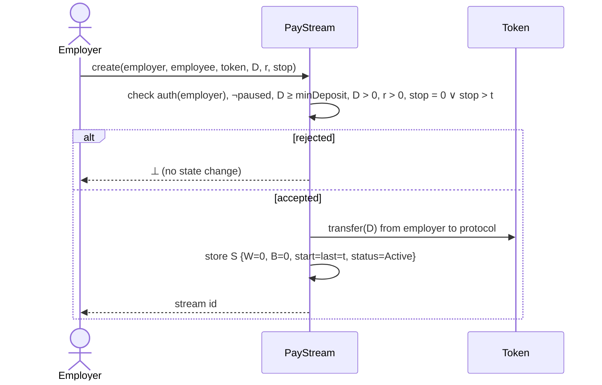
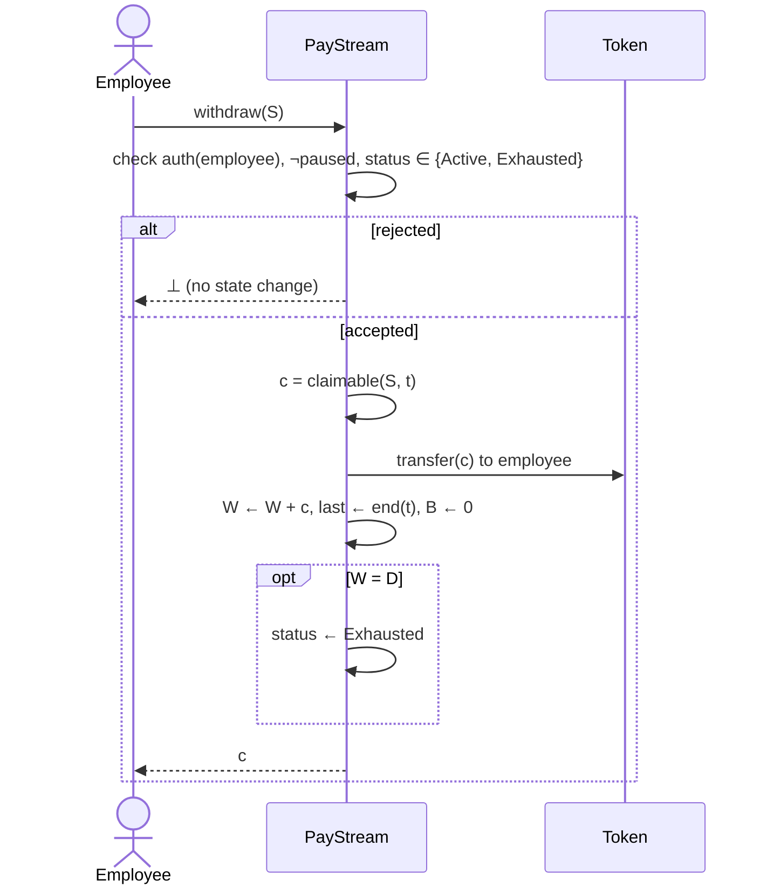
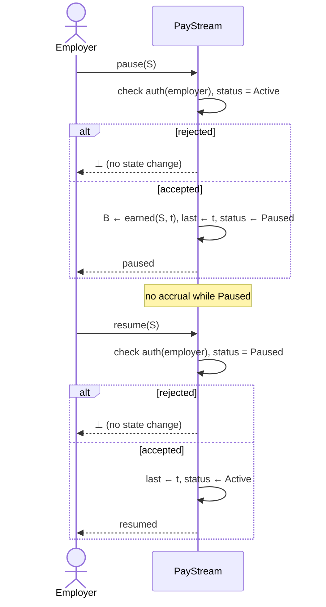
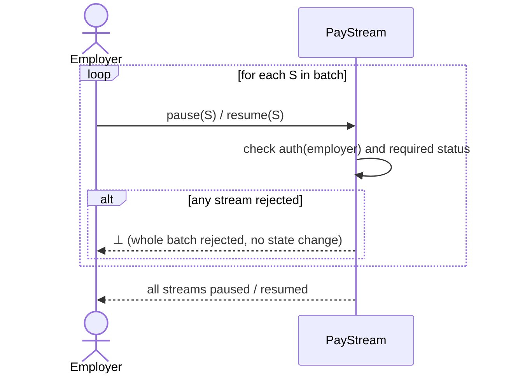
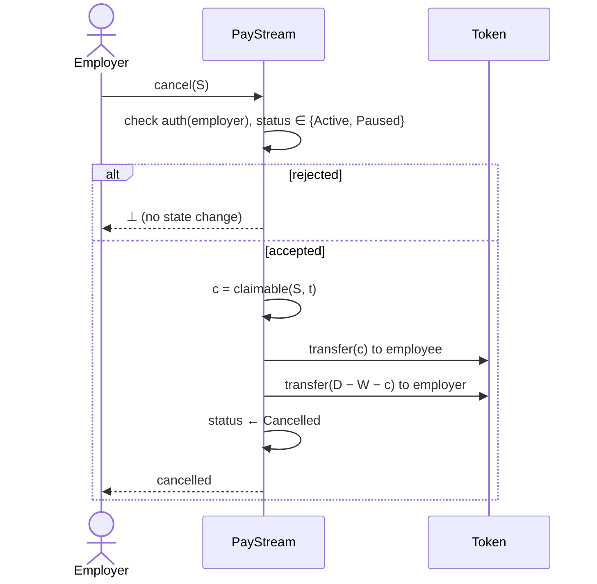
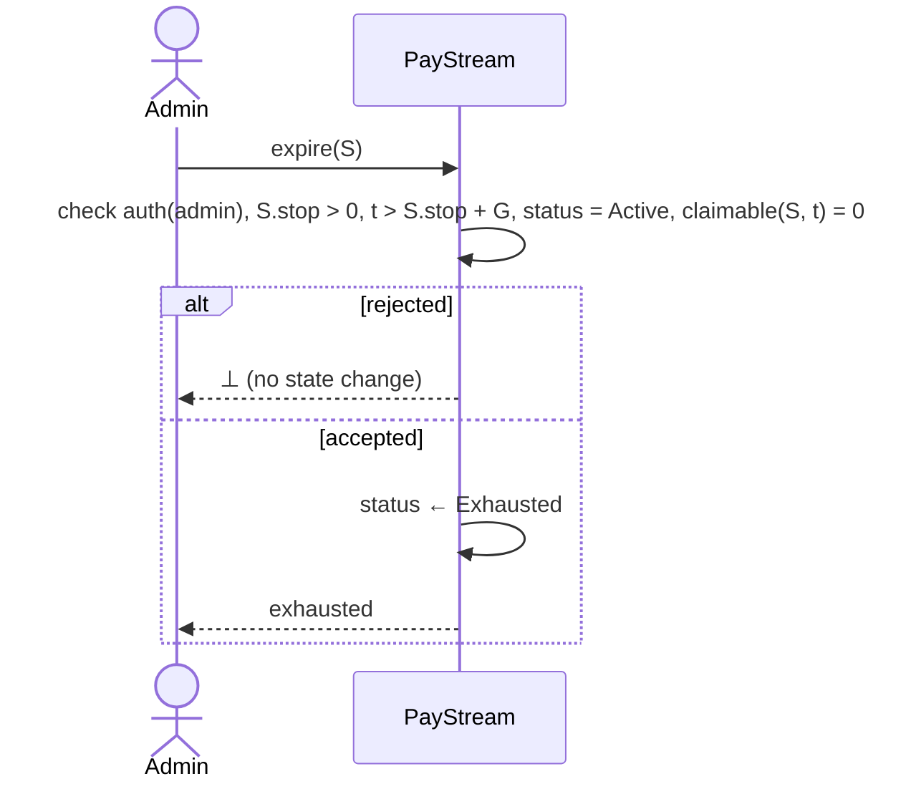
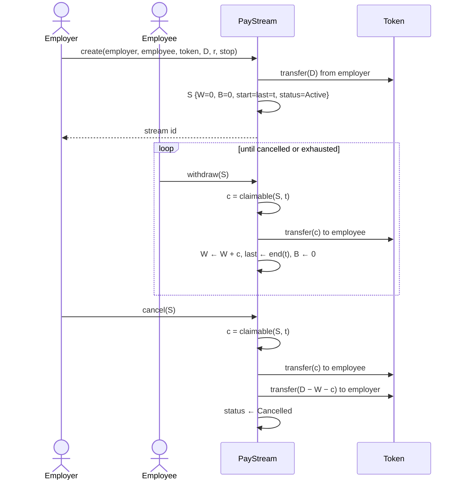
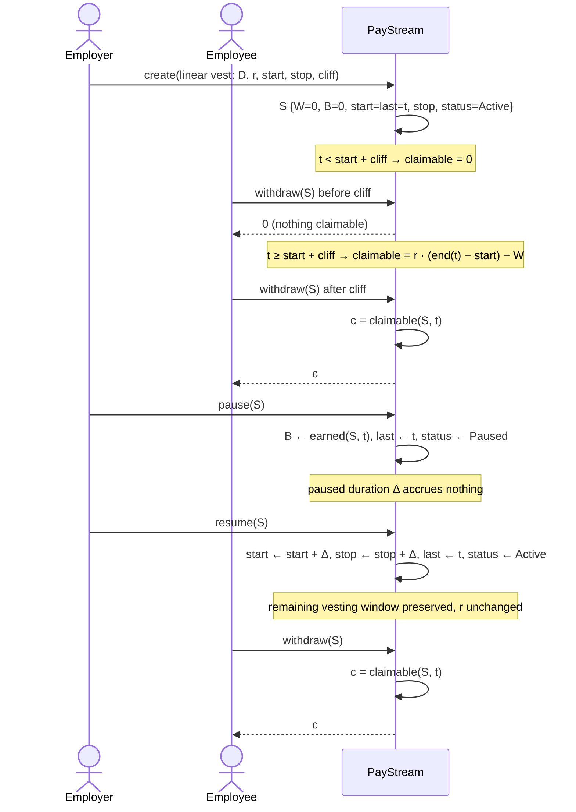

# PayStream Protocol Specification

Status: **Draft**. Must be reviewed and signed off before mainnet launch.

This document describes PayStream as an abstract state machine, independent of Soroban or Rust. It is meant for alternative implementations, formal verification and regulatory review. Where this spec and the reference implementation (`contracts/stream`) disagree, file an issue.

## 1. Notation

- `t` — current time (ledger timestamp, seconds). Time never decreases.
- `S` — a stream record. Fields are accessed as `S.field`.
- `min(a, b)`, `max(a, b)` — usual meaning. All amounts are integers in token base units.
- `⊥` — "operation rejected"; a rejected operation changes no state.
- `auth(x)` — the operation is authorised by party `x`.

## 2. State

Global state:

| Symbol | Meaning |
|--------|---------|
| `admin` | Admin party |
| `paused` ∈ {true, false} | Global pause flag |
| `minDeposit` | Minimum deposit for new streams |
| `streams : id → S` | Stream records |

Stream record `S`:

| Field | Meaning |
|-------|---------|
| `employer`, `employee` | Parties |
| `token` | Token being streamed |
| `deposit` | Total funded amount (D) |
| `withdrawn` | Total paid to employee (W) |
| `rate` | Tokens per second (r > 0) |
| `start` | Start time |
| `stop` | Hard stop time, or 0 for none |
| `last` | Time accrual was last settled |
| `banked` | Accrual banked at an earlier rate (B) |
| `status` ∈ {Active, Paused, Cancelled, Exhausted} | Lifecycle state |
| `immutable` ∈ {true, false} | When true, the employer may never cancel or pause the stream |
| `type` ∈ {Linear, Milestone} | Accrual model (see §3.1) |
| `milestones` | For `Milestone` streams: ordered list of `(timestamp, fraction)` pairs; empty for `Linear` streams |
| `rateSchedule` | Optional ordered list of `(timestamp, rate)` pairs; empty when no forward schedule is configured |
| `metadata : key → value` | Optional bounded map of short string pairs (e.g. `department`, `cost_center`) for off-chain categorisation |
| `splits` | Optional list of `(beneficiary, bps)` pairs; empty for non-split streams |

### 2.1 Metadata

`metadata` is a small map of short string keys to short string values, attached at create time and replaceable on update. It is purely descriptive: it never affects accrual, claimable amounts or payouts, and it is readable via a query. The map is bounded: at most `MAX_METADATA_ENTRIES` entries, each key and value at most `MAX_METADATA_LEN` bytes. An operation that would exceed either cap is rejected (`⊥`). Storing metadata must not change any other field of `S`.

### 2.2 Split beneficiaries

A stream may carry `splits`, a list of `(beneficiary, bps)` pairs where each `bps` is in basis points (1 bps = 0.01%). Splits are allowed on payroll streams and on linear vest streams. The list is valid when it is non-empty, every `bps > 0`, every beneficiary is distinct, and `Σ bps ≤ 10000`. The remainder `10000 − Σ bps` (if any) accrues to `S.employee`. When `splits` is empty, the whole claimable amount goes to `S.employee`.

## 3. Accrual formula

Let `end(t) = min(t, S.stop)` if `S.stop > 0`, else `t`.

```
earned(S, t)    = r · max(0, end(t) − S.last) + S.banked        if status ∈ {Active, Paused}
claimable(S, t) = min(earned(S, t), D − W)                      if status ∈ {Active, Paused}
claimable(S, t) = 0                                             if status ∈ {Cancelled, Exhausted}
```

Arithmetic overflow rejects the operation (`⊥`). It never wraps.

For a split stream, the claimable amount is divided among the beneficiaries. For each `(b, bps)` in `S.splits`:

```
share(b, S, t) = floor(claimable(S, t) · bps / 10000)
```

and the employee receives `claimable(S, t) − Σ share(b, S, t)`. Rounding dust therefore always stays with the employee, so the shares plus the employee's portion sum exactly to `claimable(S, t)`.

### 3.1 Milestone vesting

A stream with `type = Milestone` accrues in discrete steps instead of linearly. `S.milestones` is a non-empty list of `(timestamp, fraction)` pairs, strictly increasing in `timestamp`, with every `fraction > 0` and `Σ fraction ≤ 10000` (basis points, as in §2.2). The remainder `10000 − Σ fraction` never vests.

Let `vested(S, t) = Σ { fraction | (ts, fraction) ∈ S.milestones ∧ ts ≤ t }`. Then:

```
earned(S, t)    = floor(D · vested(S, t) / 10000)               if status ∈ {Active, Paused}
claimable(S, t) = min(earned(S, t), D − W)                      if status ∈ {Active, Paused}
```

A milestone is vested exactly at its timestamp: for `t = ts` the pair is included, for `t < ts` it is not. `S.rate` is unused for milestone streams (it may be 0) and `S.banked` is always 0. A cliff is expressed by omitting milestones before the cliff time; the first milestone then releases its fraction all at once. Splits (§2.2) apply to milestone claimable amounts exactly as for linear streams.

### 3.2 Dynamic rate schedule

`S.rateSchedule` is an optional ordered list of `(timestamp, rate)` pairs, strictly increasing in `timestamp`, with every `rate > 0` and every `timestamp > S.start`. The active rate at time `t` is:

```
activeRate(S, t) = rate of the last (ts, rate) ∈ S.rateSchedule with ts ≤ t, if any
activeRate(S, t) = S.rate, otherwise
```

Validation rejects (`⊥`) a schedule that is unsorted, contains duplicate timestamps, contains a non-positive rate, or contains a timestamp at or before `S.start`. Gaps between entries are allowed: the previous rate stays active until the next entry. Overlaps are impossible because timestamps are unique and strictly increasing.

For a linear stream with a schedule, accrual is computed piecewise: between two schedule timestamps the active rate is constant, so `earned` is the sum of `rate · Δ` over each segment, plus `S.banked`. A schedule may be supplied at create time or replaced by `updateRateSchedule` (§4.4.1). Replacing a schedule settles accrual at the old schedule first, so already-earned amounts are never recomputed. Milestone streams ignore `rateSchedule`.

## 4. Operations

### 4.1 Create

`create(employer, employee, token, D, r, stop)` requires `auth(employer)`, `¬paused`, `D ≥ minDeposit`, `D > 0`, `r > 0`, and `stop = 0 ∨ stop > t`.

Effect: `D` tokens move from employer to the protocol. A new `S` is stored with `W = 0`, `B = 0`, `start = last = t`, `status = Active`, `immutable = false`, `type = Linear`, empty `milestones`, empty `rateSchedule`, empty `splits`, and the supplied `metadata` (default empty).

`createImmutable(employer, employee, token, D, r, stop)` is the same operation with `immutable = true`. An immutable stream can never be cancelled or paused by the employer (§4.5, §4.7), but the employee may still withdraw (§4.2) and the employer may still top up (§4.3). The flag is fixed at create time and cannot be changed afterwards.

`createMilestone(employer, employee, token, D, milestones, stop)` creates a stream with `type = Milestone` and the supplied `milestones`, which must be valid per §3.1. `r` is stored as 0.

`createScheduled(employer, employee, token, D, r, stop, rateSchedule)` creates a linear stream with the supplied `rateSchedule`, which must be valid per §3.2.

`createSplit(employer, employee, token, D, r, stop, splits, metadata)` is the same operation with the additional requirements that `splits` is valid per §2.2 and `metadata` satisfies the caps in §2.1. It is available for payroll streams and for linear vest streams; the vest variant (`createSplitVest`) additionally requires `stop > t` and applies the same split rules to vesting claimable amounts.



### 4.2 Withdraw

`withdraw(S)` requires `auth(S.receiptHolder)`, `¬paused`, and `S.status ∈ {Active, Exhausted}`.

Effect: let `c = claimable(S, t)`. Then `c` tokens are distributed: each split beneficiary `b` receives `share(b, S, t)` and the employee receives the remainder. If `S.split` is empty, all `c` go to `S.receiptHolder`; otherwise each beneficiary `(p, share)` receives `floor(c · share)` and the remainder goes to `S.receiptHolder`. Then `W ← W + c`, `last ← end(t)`, `B ← 0`. If `W = D`, then `status ← Exhausted`.

Split beneficiaries are honoured regardless of who holds the receipt: a receipt transfer changes only who may call `withdraw` and who receives the non-split remainder, never the beneficiaries' shares.

`withdrawTo(S, to)` requires `auth(S.employee)`, `¬paused`, and `S.status ∈ {Active, Exhausted}`. It is identical to `withdraw(S)` except that the employee's portion (the remainder after split shares) is transferred to `to` instead of to `S.employee`. Split beneficiaries are unaffected and still receive their shares. The operation emits an event naming `to`. `to` need not be the employee; the employee's authorisation is what matters, so a compromised `to` cannot move funds without the employee's signature.



### 4.3 Top up

`topUp(S, a)` requires `auth(S.employer)`, `a > 0`, and `S.status ∈ {Active, Paused}`. Effect: `D ← D + a`.

### 4.3.1 Metadata update

`updateMetadata(S, metadata)` requires `auth(S.employer)` and `S.status ∈ {Active, Paused}`. The new map must satisfy the caps in §2.1. Effect: `S.metadata ← metadata`. No other field changes and no tokens move.

### 4.4 Rate update

`updateRate(S, r')` requires `auth(S.employer)` and `r' > 0`. Effect: `B ← earned(S, t)`, `last ← t`, `r ← r'`. Accrual earned at the old rate is kept.

### 4.4.1 Rate schedule update

`updateRateSchedule(S, rateSchedule)` requires `auth(S.employer)` and `S.status ∈ {Active, Paused}`. The new schedule must be valid per §3.2. Effect: `B ← earned(S, t)`, `last ← t`, `S.rateSchedule ← rateSchedule`. Accrual earned under the old schedule is kept; the new schedule applies from `t` onwards.

### 4.5 Pause / resume (per stream)

- `pause(S)` requires `auth(S.employer)`, `status = Active`, and `¬S.immutable`. Effect: `B ← earned(S, t)`, `last ← t`, `status ← Paused`.
- `resume(S)` requires `auth(S.employer)` and `status = Paused`. Effect: `last ← t`, `status ← Active`.

No accrual happens between `pause` and `resume`.



Batch pause/resume applies the same per-stream checks and effects to each stream in the batch; if any stream fails its check the whole batch is rejected (`⊥`) and no stream changes state.



### 4.6 Global pause

`pauseContract` / `unpauseContract` require `auth(admin)`. Effect: set `paused`. While `paused`, state-changing user operations (create, withdraw) are rejected. Reads still work and no stream fields change.

### 4.7 Cancel

`cancel(S)` requires `auth(S.employer)`, `status ∈ {Active, Paused}`, and `¬S.immutable`. Effect: let `c = claimable(S, t)`. The employee receives `c`, the employer receives `D − W − c`, and `status ← Cancelled`. An immutable stream can therefore only leave `Active` by becoming `Exhausted` (or by admin `expire`, §4.8).



### 4.8 Expire

`expire(S)` requires `auth(admin)`, `S.stop > 0`, `t > S.stop + G` where `G` is the grace period (7 days), `status = Active`, and `claimable(S, t) = 0`. Effect: `status ← Exhausted`.



## 5. State machine

```
           pause            resume
 Active ─────────► Paused ─────────► Active
   │  │                │
   │  └── cancel ──────┴──► Cancelled   (terminal)
   │
   └── W = D or expire ──► Exhausted    (terminal)
```

### 5.1 Core flow: create → withdraw → cancel



### 5.2 Linear vest path (cliff and schedule shift)

For a linear vest stream the accrual is a straight line from `start` to `stop` at rate `r`, with an optional cliff: no tokens are claimable before `start + cliff`, and at the cliff the full amount accrued since `start` becomes claimable. `pause`/`resume` shift the schedule so that the remaining vesting window is preserved: `resume` moves `start` and `stop` forward by the paused duration, keeping `r` and the remaining amount unchanged.



## 6. Invariants

For every stream `S` and every reachable state:

1. **Solvency:** `0 ≤ W ≤ D`.
2. **Bounded claim:** `claimable(S, t) ≤ D − W`.
3. **No over-withdrawal:** the employee has received exactly `W` in total, so the sum of all withdrawals is at most `D`.
4. **Earned funds are protected from the employer:** no operation authorised only by the employer moves `claimable(S, t)` to anyone but the employee (or, on a split stream, the beneficiaries and receipt holder per §4.2). Cancel pays `claimable` to the employee before refunding the employer.
5. **Monotonic accrual:** for `t₁ ≤ t₂` with no operations in between, `earned(S, t₁) ≤ earned(S, t₂)`.
6. **Terminal states:** `Cancelled` and `Exhausted` have `claimable = 0` and accept no further accrual.
7. **Conservation:** the protocol's token balance is at least `Σ (D − W)` over all non-terminal streams.
8. **Split conservation:** for a split stream, the sum of all beneficiary shares plus the employee's portion equals `claimable(S, t)` exactly; no share exceeds its basis-point fraction of `claimable(S, t)`.
9. **Metadata isolation:** `metadata` never influences accrual, claimable amounts, splits or payouts, and satisfies the caps in §2.1 in every reachable state.
10. **Immutability:** for a stream with `immutable = true`, no operation authorised only by the employer can move it to `Paused` or `Cancelled`. Its `claimable` is therefore only ever paid out to the employee (or split beneficiaries), never refunded to the employer.
11. **Milestone monotonicity:** for a milestone stream, `vested(S, t)` is non-decreasing in `t`, `vested(S, t) ≤ 10000`, and `earned(S, t) ≤ D`.
12. **Schedule consistency:** in every reachable state, `rateSchedule` is sorted, has unique timestamps, positive rates, and timestamps strictly after `start`; the active rate is always positive.
13. **Delegated withdrawal:** `withdrawTo` moves exactly the same total `c` as `withdraw` would at the same `t`; only the recipient of the employee's portion differs, and it requires the employee's authorisation.

## 7. Sign-off

| Role | Name | Date |
|------|------|------|
| Protocol lead | | |
| Security reviewer | | |
