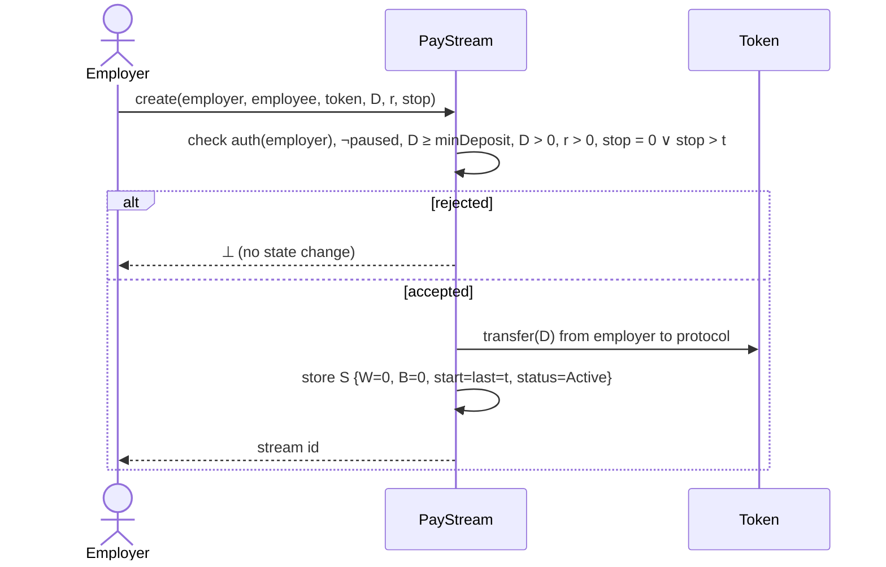
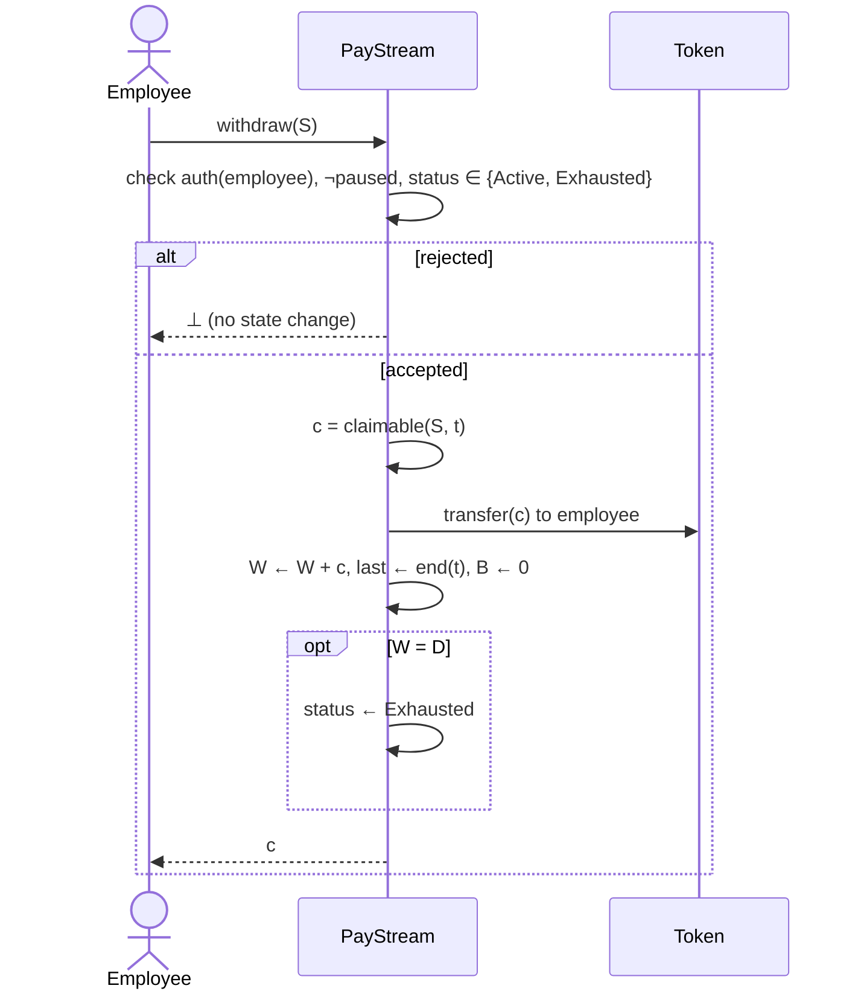
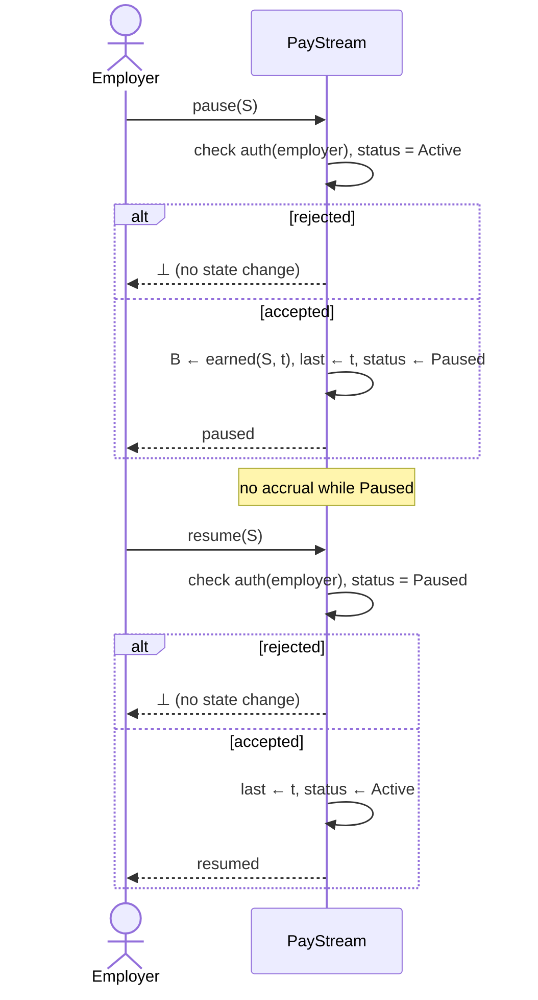
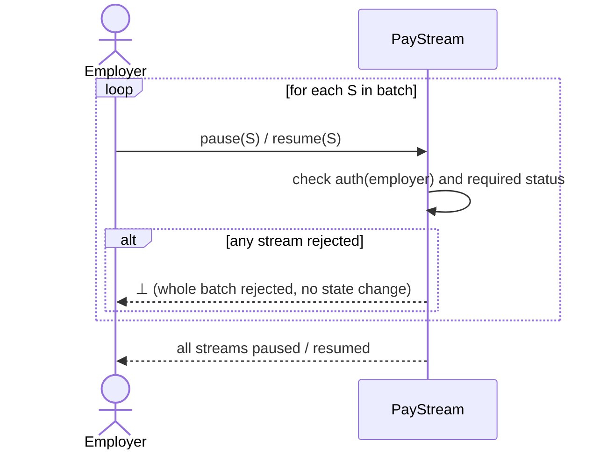
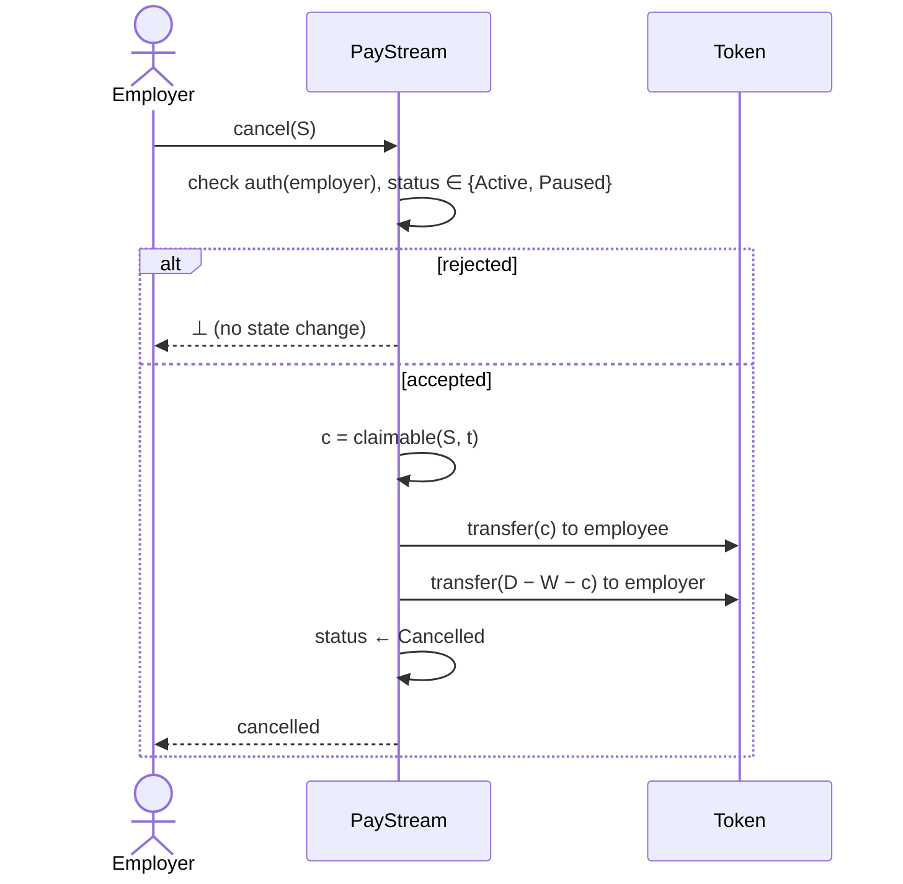
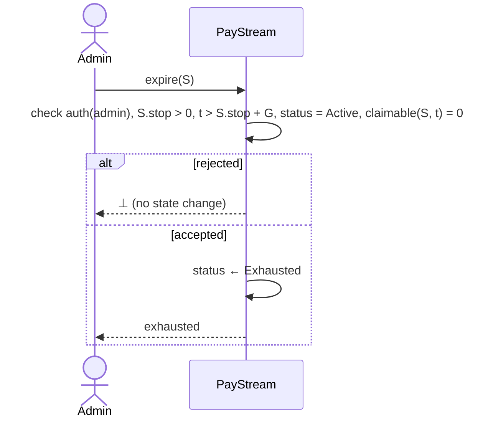
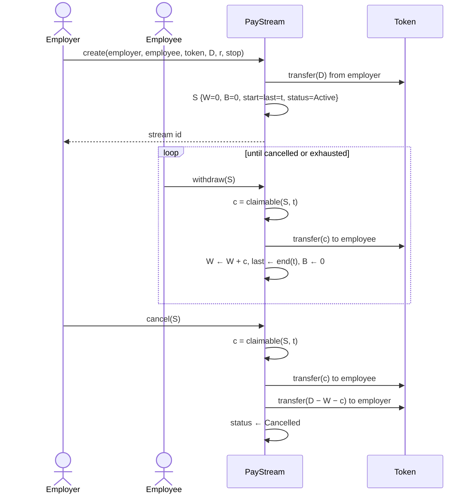
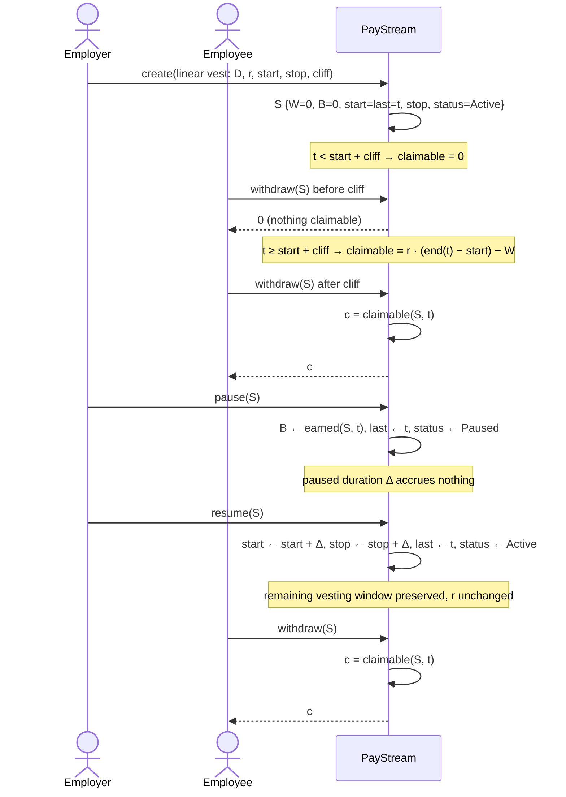

# PayStream Protocol Specification

Status: **Draft**. Must be reviewed and signed off before mainnet launch.

This document describes PayStream as an abstract state machine, independent of Soroban or Rust. It is meant for alternative implementations, formal verification and regulatory review. Where this spec and the reference implementation (`contracts/stream`) disagree, file an issue.

## 1. Notation

- `t` — current time (ledger timestamp, seconds). Time never decreases.
- `S` — a stream record. Fields are accessed as `S.field`.
- `min(a, b)`, `max(a, b)` — usual meaning. All amounts are integers in token base units.
- `⊥` — "operation rejected"; a rejected operation changes no state.
- `auth(x)` — the operation is authorised by party `x`.

## 2. State

Global state:

| Symbol | Meaning |
|--------|---------|
| `admin` | Admin party |
| `paused` ∈ {true, false} | Global pause flag |
| `minDeposit` | Minimum deposit for new streams |
| `streams : id → S` | Stream records |

Stream record `S`:

| Field | Meaning |
|-------|---------|
| `employer`, `employee` | Parties |
| `token` | Token being streamed |
| `deposit` | Total funded amount (D) |
| `withdrawn` | Total paid to employee (W) |
| `rate` | Tokens per second (r > 0) |
| `start` | Start time |
| `stop` | Hard stop time, or 0 for none |
| `last` | Time accrual was last settled |
| `banked` | Accrual banked at an earlier rate (B) |
| `status` ∈ {Active, Paused, Cancelled, Exhausted} | Lifecycle state |

## 3. Accrual formula

Let `end(t) = min(t, S.stop)` if `S.stop > 0`, else `t`.

```
earned(S, t)    = r · max(0, end(t) − S.last) + S.banked        if status ∈ {Active, Paused}
claimable(S, t) = min(earned(S, t), D − W)                      if status ∈ {Active, Paused}
claimable(S, t) = 0                                             if status ∈ {Cancelled, Exhausted}
```

Arithmetic overflow rejects the operation (`⊥`). It never wraps.

## 4. Operations

### 4.1 Create

`create(employer, employee, token, D, r, stop)` requires `auth(employer)`, `¬paused`, `D ≥ minDeposit`, `D > 0`, `r > 0`, and `stop = 0 ∨ stop > t`.

Effect: `D` tokens move from employer to the protocol. A new `S` is stored with `W = 0`, `B = 0`, `start = last = t`, `status = Active`.



### 4.2 Withdraw

`withdraw(S)` requires `auth(S.employee)`, `¬paused`, and `S.status ∈ {Active, Exhausted}`.

Effect: let `c = claimable(S, t)`. Then `c` tokens go to the employee, `W ← W + c`, `last ← end(t)`, `B ← 0`. If `W = D`, then `status ← Exhausted`.



### 4.3 Top up

`topUp(S, a)` requires `auth(S.employer)`, `a > 0`, and `S.status ∈ {Active, Paused}`. Effect: `D ← D + a`.

### 4.4 Rate update

`updateRate(S, r')` requires `auth(S.employer)` and `r' > 0`. Effect: `B ← earned(S, t)`, `last ← t`, `r ← r'`. Accrual earned at the old rate is kept.

### 4.5 Pause / resume (per stream)

- `pause(S)` requires `auth(S.employer)` and `status = Active`. Effect: `B ← earned(S, t)`, `last ← t`, `status ← Paused`.
- `resume(S)` requires `auth(S.employer)` and `status = Paused`. Effect: `last ← t`, `status ← Active`.

No accrual happens between `pause` and `resume`.



Batch pause/resume applies the same per-stream checks and effects to each stream in the batch; if any stream fails its check the whole batch is rejected (`⊥`) and no stream changes state.



### 4.6 Global pause

`pauseContract` / `unpauseContract` require `auth(admin)`. Effect: set `paused`. While `paused`, state-changing user operations (create, withdraw) are rejected. Reads still work and no stream fields change.

### 4.7 Cancel

`cancel(S)` requires `auth(S.employer)` and `status ∈ {Active, Paused}`. Effect: let `c = claimable(S, t)`. The employee receives `c`, the employer receives `D − W − c`, and `status ← Cancelled`.



### 4.8 Expire

`expire(S)` requires `auth(admin)`, `S.stop > 0`, `t > S.stop + G` where `G` is the grace period (7 days), `status = Active`, and `claimable(S, t) = 0`. Effect: `status ← Exhausted`.



## 5. State machine

```
           pause            resume
 Active ─────────► Paused ─────────► Active
   │  │                │
   │  └── cancel ──────┴──► Cancelled   (terminal)
   │
   └── W = D or expire ──► Exhausted    (terminal)
```

### 5.1 Core flow: create → withdraw → cancel



### 5.2 Linear vest path (cliff and schedule shift)

For a linear vest stream the accrual is a straight line from `start` to `stop` at rate `r`, with an optional cliff: no tokens are claimable before `start + cliff`, and at the cliff the full amount accrued since `start` becomes claimable. `pause`/`resume` shift the schedule so that the remaining vesting window is preserved: `resume` moves `start` and `stop` forward by the paused duration, keeping `r` and the remaining amount unchanged.



## 6. Invariants

For every stream `S` and every reachable state:

1. **Solvency:** `0 ≤ W ≤ D`.
2. **Bounded claim:** `claimable(S, t) ≤ D − W`.
3. **No over-withdrawal:** the employee has received exactly `W` in total, so the sum of all withdrawals is at most `D`.
4. **Earned funds are protected from the employer:** no operation authorised only by the employer moves `claimable(S, t)` to anyone but the employee. Cancel pays `claimable` to the employee before refunding the employer.
5. **Monotonic accrual:** for `t₁ ≤ t₂` with no operations in between, `earned(S, t₁) ≤ earned(S, t₂)`.
6. **Terminal states:** `Cancelled` and `Exhausted` have `claimable = 0` and accept no further accrual.
7. **Conservation:** the protocol's token balance is at least `Σ (D − W)` over all non-terminal streams.

## 7. Sign-off

| Role | Name | Date |
|------|------|------|
| Protocol lead | | |
| Security reviewer | | |
