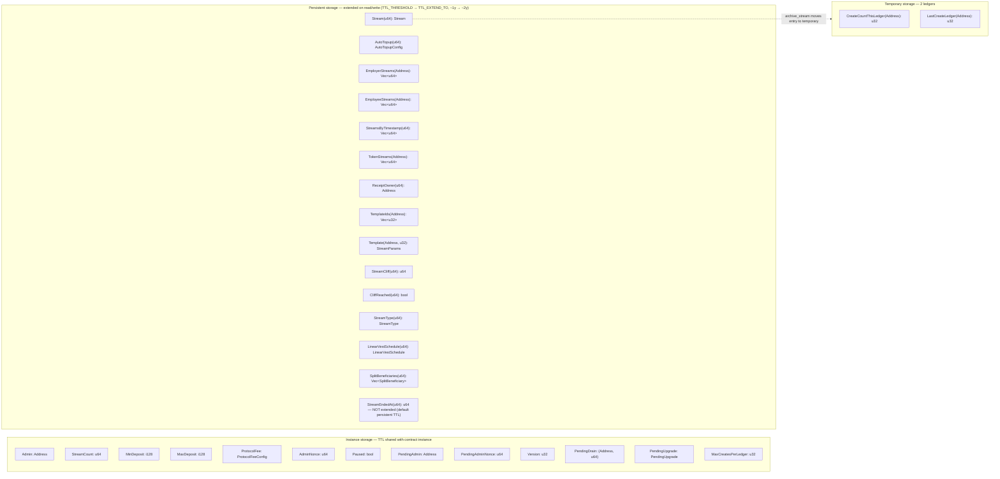

# Storage Layout

Reference for off-chain indexers that read PayStream **stream contract** ledger state directly.
Source of truth: `DataKey` in `contracts/stream/src/types.rs` and the accessors in
`contracts/stream/src/storage.rs`.

---

## Key encoding (XDR)

`DataKey` is a `#[contracttype]` enum, so each key is encoded as an `ScVal::Vec`:

- **Unit variant** (e.g. `Admin`) → `Vec[ Symbol("Admin") ]`
- **Tuple variant** (e.g. `Stream(u64)`) → `Vec[ Symbol("Stream"), <payload> ]`

`u64` payloads encode as `ScVal::U64`; `Address` payloads encode as `ScVal::Address`.

Example: the key for stream `7` is `Vec[ Symbol("Stream"), U64(7) ]`.

---

## Storage class diagram

Visual map of every `DataKey` variant to its storage class and TTL behavior, grouped by
class. Source of truth: the `DataKey` enum in `contracts/stream/src/types.rs`.



**Legend**

| Class | TTL behavior | Rent implications |
|---|---|---|
| Instance | Shares the TTL of the contract instance entry; extended whenever the instance is bumped. | Rent is paid once for the instance entry as a whole, not per key; adding instance keys grows the instance entry size and therefore its rent. |
| Persistent | Extended on read/write from `TTL_THRESHOLD` (`6_307_200` ledgers, ~1y) to `TTL_EXTEND_TO` (`12_614_400` ledgers, ~2y). `StreamEndedAt` is never extended. | Each entry pays rent for its own footprint; entries left untouched past their TTL are archived and must be restored (paying rent again) before on-chain reads succeed. |
| Temporary | Lives for 2 ledgers, then is dropped automatically. | Cheapest class; rent is negligible and no restore is possible — entries simply vanish and are recreated on demand. |

> **Keep this diagram in sync.** Any PR that adds, removes, or changes a `DataKey` variant in
> `contracts/stream/src/types.rs` must update this diagram (and the table below) in the same PR.

---

## Keys

Every `DataKey` variant in `contracts/stream/src/types.rs`, in declaration order.

| Key | Value Type | Storage | TTL | Set by | Read by |
|---|---|---|---|---|---|
| `Stream(u64)` | `Stream` | Persistent (Temporary once archived) | Extended on read/write (1y → 2y) | `create_stream`, `withdraw`, `top_up`, `pause_stream`, `cancel_stream`, …; moved to temporary by `archive_stream` | `get_stream`, `claimable`, all stream entry points |
| `StreamCount` | `u64` | Instance | Instance | `create_stream` / batch create (`next_id`) | `stream_count`, `next_id` |
| `Admin` | `Address` | Instance | Instance | `initialize`, `accept_admin` | Every admin entry point |
| `AutoTopup(u64)` | `AutoTopupConfig` | Persistent | Extended on read/write (1y → 2y) | `set_auto_topup`; removed on disable | `get_auto_topup`, top-up trigger |
| `MinDeposit` | `i128` | Instance | Instance | `set_min_deposit` | `create_stream` validation (absent = `10_000`) |
| `MaxDeposit` | `i128` | Instance | Instance | `set_max_deposit` | `create_stream` / `top_up` validation (absent = no cap) |
| `ProtocolFee` | `ProtocolFeeConfig` | Instance | Instance | `set_protocol_fee` | `create_stream` / `top_up` fee calculation (absent = 0 bps) |
| `AdminNonce` | `u64` | Instance | Instance | Every nonce-protected admin call | `admin_nonce`, `consume_admin_nonce` |
| `Paused` | `bool` | Instance | Instance | `pause_contract` / `unpause_contract` | All state-changing entry points (absent = `false`) |
| `PendingAdmin` | `Address` | Instance | Instance | `propose_admin`; removed by `accept_admin` | `accept_admin`, `get_pending_admin` |
| `PendingAdminNonce` | `u64` | Instance | Instance | `propose_admin`; removed by `accept_admin` | `accept_admin` |
| `EmployerStreams(Address)` | `Vec<u64>` | Persistent | Extended on read/write (1y → 2y) | `create_stream`, `transfer_stream` | `get_employer_streams` |
| `EmployerStreamsArchive(Address)` | `Vec<u64>` | Temporary | Extended on write (1y → 2y) | Archival routine (SC-93) | `get_employer_streams` |
| `EmployeeStreams(Address)` | `Vec<u64>` | Persistent | Extended on read/write (1y → 2y) | `create_stream`, `transfer_receipt` | `get_employee_streams` |
| `EmployeeStreamsArchive(Address)` | `Vec<u64>` | Temporary | Extended on write (1y → 2y) | Archival routine (SC-93) | `get_employee_streams` |
| `Version` | `u32` | Instance | Instance | `migrate` | `version` |
| `PendingDrain` | `(Address, u64)` | Instance | Instance | `propose_emergency_drain` (reserved, SEC-03) | `emergency_drain` |
| `StreamsByTimestamp(u64)` | `Vec<u64>` | Persistent | Extended on read/write (1y → 2y) | `create_stream` (bucket = `timestamp / 86_400`) | Time-range queries |
| `TokenStreams(Address)` | `Vec<u64>` | Persistent | Extended on read/write (1y → 2y) | `create_stream` | Token-filtered queries |
| `TokenStreamsArchive(Address)` | `Vec<u64>` | Temporary | Extended on write (1y → 2y) | Archival routine (SC-93) | Token-filtered queries |
| `ReceiptOwner(u64)` | `Address` | Persistent | Extended on read/write (1y → 2y) on write | `transfer_receipt` | `receipt_owner` (absent = `stream.employee`) |
| `TemplateIds(Address)` | `Vec<u32>` | Persistent | Extended on read/write (1y → 2y) | `save_template`, `delete_template` | `list_templates` |
| `Template(Address, u32)` | `StreamParams` | Persistent | Extended on read/write (1y → 2y) | `save_template` | `create_stream_from_template`, `get_template` |
| `StreamCliff(u64)` | `u64` | Persistent | Extended on read/write (1y → 2y) | `create_stream` with cliff (PROD-17) | `claimable`, `withdraw` |
| `CliffReached(u64)` | `bool` | Persistent | Extended on read/write (1y → 2y) | First withdraw/claim after cliff | `mark_cliff_reached` (emit `cliff_reached` once) |
| `StreamType(u64)` | `StreamType` | Persistent | Extended on read/write (1y → 2y) (LinearVest only) | Linear-vest stream creation | `get_stream_type` (absent = `Payroll`) |
| `LinearVestSchedule(u64)` | `LinearVestSchedule` | Persistent | Extended on read/write (1y → 2y) | Linear-vest stream creation | `linear_vest_claimable_amount` |
| `PendingUpgrade` | `PendingUpgrade` | Instance | Instance | `propose_upgrade`; removed by `execute_upgrade` / `cancel_upgrade` | `execute_upgrade`, `cancel_upgrade` |
| `StreamEndedAt(u64)` | `u64` | Persistent | Not extended (default persistent TTL) | Transition to Cancelled / Exhausted | `archive_stream` (30-day wait) |
| `MaxCreatesPerLedger` | `u32` | Instance | Instance | `set_max_creates_per_ledger` | Rate limiter (absent = 50) |
| `CreateCountThisLedger(Address)` | `u32` | Temporary | 2 ledgers | `check_and_increment_create_rate` | Rate limiter |
| `LastCreateLedger(Address)` | `u32` | Temporary | 2 ledgers | `check_and_increment_create_rate` | Rate limiter |
| `SplitBeneficiaries(u64)` | `Vec<SplitBeneficiary>` | Persistent | Extended on read/write (1y → 2y) | Split stream creation (PROD-22) | Split withdrawals |
| `StreamCold(u64)` | `StreamColdData` | Persistent | Extended on read/write (1y → 2y) | `create_stream` (when cold fields set), `set_low_balance_threshold`, `pause_stream` (SC-107) | `get_stream`, `claimable`, low-balance checks, pause-reason reads |
| `StreamMetadata(u64)` | `Map<Symbol, String>` | Persistent | Extended on read/write (1y → 2y) | `create_stream` / `update_stream_metadata` (bounded, cap enforced) | `get_stream_metadata` |
| `MaxBatchSize` | `u32` | Instance | Instance | `set_max_batch_size` (bounds `1..=200`) | All batch entry points (absent = 50) |
| `StreamImmutable(u64)` | `bool` | Persistent | Extended on read/write (1y → 2y) | `create_stream` with `immutable = true` (SC-77) | `cancel_stream`, `pause_stream` (reject when `true`); `is_stream_immutable` (absent = `false`) |
| `MilestoneSchedule(u64)` | `Vec<(u64, u32)>` | Persistent | Extended on read/write (1y → 2y) | Milestone stream creation (SC-78) | `claimable`, `withdraw`, `get_milestone_schedule` |
| `RateSchedule(u64)` | `Vec<(u64, i128)>` | Persistent | Extended on read/write (1y → 2y) | `create_stream` / `update_rate_schedule` (sorted, gaps/overlaps validated) (SC-79) | `claimable`, `withdraw`, `get_rate_schedule` |

> **Keep this table current.** Any PR that adds, removes, or changes a `DataKey` variant must update this table in the same PR (reviewers: check this).

### Secondary index archival (SC-93)

The `EmployerStreams`, `EmployeeStreams`, and `TokenStreams` indexes are the largest
rent-paying persistent entries: each grows with every stream created for an address or
token and is extended to a 2-year TTL on every read/write. For older or completed
streams these entries are rarely queried but keep paying rent indefinitely.

To cut that rent, the archival routine moves entries for completed streams out of the
persistent index and into the corresponding `*Archive` key in **temporary** storage.
Temporary entries are cheaper (no persistent rent floor) and expire automatically once
their TTL lapses, so no explicit cleanup transaction is needed. The index queries
(`get_employer_streams`, `get_employee_streams`, token-filtered queries) read both the
persistent and archive keys and merge the results, so there is no query regression:
callers see the same stream IDs as before. Indexers reading ledger state directly must
therefore consult both the persistent and `*Archive` keys for these three indexes.

### `Stream` value

`Stream` is a `#[contracttype]` struct, encoded as an `ScVal::Map` keyed by field name
(`Symbol`), sorted alphabetically:

| Field | Type | Meaning |
|---|---|---|
| `deposit` | `i128` | Total deposited amount |
| `employee` | `Address` | Recipient |
| `employer` | `Address` | Funder |
| `id` | `u64` | Stream ID |
| `last_withdraw_time` | `u64` | Ledger timestamp of the last withdrawal |
| `locked` | `bool` | Reentrancy guard (normally `false` between transactions) |
| `metadata` | `Map<Symbol, String>` | Optional bounded metadata map (e.g. department, cost center); empty when unset |
| `rate_per_second` | `i128` | Tokens streamed per second |
| `start_time` | `u64` | Ledger timestamp the stream started |
| `status` | `StreamStatus` | `Vec[Symbol("Active" \| "Paused" \| "Cancelled" \| "Exhausted")]` |
| `stop_time` | `u64` | Hard stop timestamp (`0` = no end) |
| `token` | `Address` | Token contract address |
| `withdrawn` | `i128` | Total already withdrawn |

### `StreamColdData` value

`StreamColdData` is a `#[contracttype]` struct stored under `StreamCold(u64)`, encoded as an
`ScVal::Map` keyed by field name (`Symbol`), sorted alphabetically:

| Field | Type | Meaning |
|---|---|---|
| `low_balance_threshold` | `i128` | Threshold below which the stream is considered low-balance (`0` = disabled) |
| `pause_reason` | `Symbol` | Reason recorded when the stream was paused |

These fields are **cold**: they are rarely read or written, so SC-107 relocated them out of
the hot `Stream` entry into a separate persistent entry. Streams that never set a
low-balance threshold and were never paused have no `StreamCold` entry at all (absent =
`low_balance_threshold` `0`, no `pause_reason`). Indexers should treat `StreamCold` as
optional and fall back to those defaults.

Legacy `Stream` values written before SC-107 may still carry `low_balance_threshold` and
`pause_reason` inline. Per ADR-004, decoding remains backward compatible: readers accept
both layouts, and a legacy stream is migrated to the split layout on its next write.

#### Measured rent savings (SC-107)

Per-stream rent was measured with the snapshot test
`contracts/stream/src/test.rs::sc107_stream_rent_savings` (Soroban rent model, 1-year
persistent TTL):

| Layout | Rent per stream | Notes |
|---|---|---|
| Before (all fields in `Stream`) | _TBD_ | Baseline |
| After (cold fields in `StreamCold`) | _TBD_ | Savings: _TBD_ |

Savings come from the smaller hot `Stream` entry; streams without cold data pay no
`StreamCold` rent at all.

---

## TTL thresholds

Persistent keys are extended on every read/write through `storage.rs` (except
`StreamEndedAt`, see table above). Temporary rate-limit keys live for 2 ledgers.
The SC-93 `*Archive` index keys are temporary but use the same 1y → 2y extension
thresholds as persistent keys, so archived entries remain queryable for as long as
active ones and then expire on their own.

| Constant | Ledgers | Approx. time (5 s/ledger) |
|---|---|---|
| `TTL_THRESHOLD` | `6_307_200` | ~1 year |
| `TTL_EXTEND_TO` | `12_614_400` | ~2 years |

When a persistent entry's remaining TTL drops below `TTL_THRESHOLD`, it is extended to
`TTL_EXTEND_TO`. Streams that are never touched for longer than their remaining TTL are
archived and must be restored before they can be read on-chain; indexers should rely on
their own copy of historical data rather than live state for archived streams.

Instance keys share the TTL of the contract instance entry.

---

## Claimable caching

`claimable(stream_id)` is a pure function of the stream's stored state and the current
ledger timestamp, so it is recomputed on every call. Off-chain services (API nodes,
indexers, dashboards) should cache the result rather than hitting the contract per
request.

### Cache key

```
claimable:{stream_id}:{ledger_second_bucket}
```

- `stream_id` — the `u64` stream ID.
- `ledger_second_bucket` — the ledger close time (in seconds) truncated to the cache
  bucket, i.e. `ledger_timestamp / CLAIMABLE_CACHE_BUCKET_SECONDS`. Bucketing keeps the
  key stable for the whole bucket so concurrent requests within the same second share a
  single entry.

Because the value is a function of ledger time, entries from different buckets are
**not** interchangeable: never serve a value computed for one bucket to a request in
another bucket.

### TTL

Entries are short-lived: `CLAIMABLE_CACHE_TTL_SECONDS` (default **5 s**, roughly one
ledger). The TTL must be at least the bucket width so a hit within a bucket is
meaningful, and short enough that a missed invalidation self-heals within one ledger.
Expired entries are dropped, not refreshed.

### Invalidation

Invalidate **all** buckets for a stream on any state-changing event for that stream:

- `withdraw` (including split withdrawals)
- `top_up`
- `pause_stream` / `resume_stream`
- `cancel_stream`
- `transfer_stream` / `transfer_receipt` (changes `employee` / receipt owner)
- `set_auto_topup` and any auto top-up trigger that credits the stream
- `archive_stream` / restore, and any admin action that mutates the stream

Invalidation is by `stream_id` prefix (`claimable:{stream_id}:*`) so no bucket needs to
be known at invalidation time. Events are consumed from the contract event stream; the
cache must also be flushed for a stream when a write to `Stream(stream_id)` is observed
out of band.

### Stale-on-error fallback

If the contract read fails (RPC error, timeout, archived stream not yet restored), the
cache **may** serve the most recent non-expired entry for the stream, even if it belongs
to an earlier bucket. This is a deliberate availability trade-off:

- The fallback is only used for read paths; it must never feed a write, a balance
  reconciliation, or a payout decision.
- Fallback responses must be marked (`stale: true` in the API payload) and logged with
  the stream ID and the age of the served entry.
- If no non-expired entry exists, the error is propagated — do not synthesize a value.
- The fallback window is bounded by the TTL above; after expiry the request fails.

### Observability

Expose a cache hit-ratio metric so the effectiveness of the cache is visible:

- `claimable_cache_requests_total{result="hit"|"miss"|"stale"|"error"}`
- `claimable_cache_hit_ratio` — `hit / (hit + miss + stale)`, computed over a rolling
  window (e.g. 5 minutes) and exported as a gauge.
- `claimable_cache_invalidations_total{stream_id}` — invalidation events processed.

A sustained hit ratio near zero indicates the bucket/TTL configuration is too small or
that invalidation is firing too aggressively; a ratio near 1.0 with stale responses
indicates the contract read path is failing.

---

## Keys affected by contract upgrades

`upgrade` / `execute_upgrade` replace the WASM only; all storage is preserved.

- `Version` — written by `migrate` after an upgrade; indexers can use it to detect schema changes.
- `AdminNonce` — incremented by every admin call, including upgrades.
- `PendingUpgrade` — set by `propose_upgrade`, cleared by `execute_upgrade` / `cancel_upgrade`.
- `Stream`, `StreamCold`, `EmployerStreams`, `EmployeeStreams` — unchanged by upgrades. If a
  future version changes the `Stream` or `StreamCold` struct layout, `Version` will be bumped
  and the change noted in `CHANGELOG.md` and [upgrade-guide.md](upgrade-guide.md).
